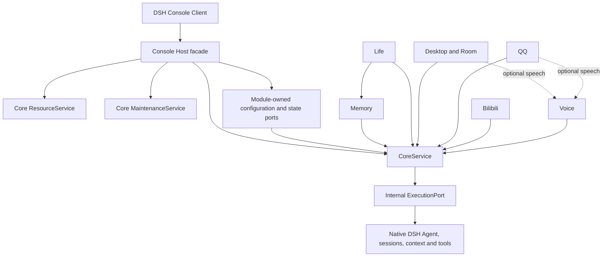

# Core And Console Implementation Plan

- Revision: v0.3, 2026-11-05, Asia/Ho_Chi_Minh.
- Status: Retained C0–C3/CC proposal and historical implementation inventory.
  [The current product plan](plan.md) replaces its execution sequence and mandatory
  workbench implications; [the handover](../handover/README.md) keeps work paused.
- Historical authorization: The earlier Core-first request applied to a previous
  batch. See [runtime/evidence](../core-runtime.md) for that delivered subset;
  it neither starts the current P1–P3 proposal nor accepts complete Core/Console.
- This plan does not authorize installing into the personal profile, connecting
  accounts, migrating personal data, staging, commit or publication.
- Historical design baseline: `4ac51de265b8b4a8f8f1cafdee8ba165d99295c0`.
  Do not interpret this old baseline or duty catalogue as current task state.

## 1. Authority, Decisions And Completion

| Record | Owns |
| --- | --- |
| [Product plan](plan.md) | Complete eight-module product goals and open experience choices |
| [Module design](modular-design.md) | Sole writers, service dependencies and lifecycle boundaries |
| [Module contracts](module-contracts.md) and [types](../../src/contracts/index.ts) | Contract 0.3 dialogue/progress and baseline module semantics |
| This plan | Core/Console work packages, workbench scope, implementation seams and local acceptance cases |
| [Reference study](reference-study.md), [project map](reference-module-map.md) and [manifest](../../references/manifest.json) | Inspected mechanisms, limitations, versions and license pointers |
| [Development plan](development-plan.md) | Overall sequence, V1–V6 validation packages and A01–A19 release cases |

The latest user clarification supersedes the earlier workbench-first scope:
**Core governs real execution, Memory owns long-term memory, and the Repo stores
persona, user profile and configuration.** Existing implementation is not evidence
that a product feature is required. In particular, an assistance ledger, custom
workbench and generated STATE.md are not prerequisites for Core completion.
Console remains a presentation/operation client when such UI is needed; it does
not create new Core requirements merely because its code already exists.
Each business module owns its settings and state.
All eight business modules remain planned; Room is a Desktop sub-capability.

TypeScript and native DSH/Cordis host the implemented Core foundation. Node's
built-in SQLite owns its records and resource bytes. The installed 0.2.1-rc.5
Agent Loop/persistence passed an isolated native check with a local fixture
model; external provider behavior and complete runtime conformance are not
accepted. One coherent distribution, UI slots and later provider bindings remain
proposals. No engine or provider is selected by a reference treatment.

The ten responsibilities below are the preceding implementation proposal, not
ten independently confirmed mandatory product features. Reassess each against
the latest user boundary and the actual execution flow before further work.
Keep necessary authorization, execution evidence, cancellation, reconciliation,
module interfaces and data protection; do not replace them with fake success.
A Core/Console checkpoint is distinct
from the whole product release. Real Memory, QQ, Voice, Bilibili and Desktop
integration results remain required for the corresponding end-to-end claims.
Fixtures can test orchestration; they cannot mark an absent provider ready.

The user subsequently authorized completing Core in full, including the accepted
repository-file and native-workspace design. The [completion record](../core-completion.md)
tracks implementation evidence and the remaining user requirements. The latest
user clarification controls the required scope; historical CC cases and existing
code cannot promote optional features into completion gates.

## 2. Core Functional Scope

| Responsibility | Implementation proposal and observable result | Public boundary / acceptance |
| --- | --- | --- |
| Identity and owner relationship | Stable companion identity independent of execution sessions; explicit character revisions and trusted owner/account/channel bindings. Session replacement preserves identity and matters. | Core identity/binding operations; CC02, CC03, CC07 |
| Conversation and context | Validate attribution, deduplicate and persist input before dispatch; order state-changing owner turns; assemble bounded identity/conversation/commitment/Memory context through supported native mechanisms. Internal reports stay separate from presented messages. | Core conversation/source operations and ExecutionPort; CC02, CC03, CC09 |
| Assistance commitments, optional | Existing matter APIs and records are an implementation to reassess. Ordinary chat and actual execution must work without creating a matter. Retain existing data; expand this product feature only for an evidenced user need. | CC04 tests the optional feature; it is not a mandatory Core completion gate |
| Activity coordination | One admission/dispatch path for owner work and autonomous proposals, including processing and speech. Persist admitted work, prioritize owner interaction, checkpoint/cancel where supported and reconcile actual progress. Life keeps the meaning of its pursuits. | Core activity operations; CC05, CC06, CC08 |
| Permission and allowances | Check real actor/binding, scope, enabled capability, policy revision, tool exposure and finite run/time/concurrency/contact limits before work. Reserve/release allowances without races; measured usage can settle later. Owner capacity remains separately managed. | Core policy/admission plus native execution limits; CC03, CC05, CC06 |
| Contact and delivery | Persist intent and each attempt before handoff. Freeze binding revision, actual account, connection and recipient; preserve source/reply association and current disclosure permission. Confirmed/failed/unknown remain different. | Core contact/attempt operations; channel supplies transport evidence; CC07, CC08 |
| Actual state and results | Validate state transitions against originating admission/provider and correlate product records with actual host turns/results. DSH owns native logs; Core stores required product records and outcomes. A finished turn is not a completed commitment. | Core receipts and execution inspect/reconcile; CC02, CC04, CC08 |
| Capabilities and common policy | Observe providers through native services, expose honest availability and common quiet/pause/contact policy. Optional service loss does not create another identity, Bank or model path. | Core capabilities/policy and ModulePort; CC01, CC05, CC13 |
| Shared resources | Core owns staging/committed bytes, catalogue, scoped reads, digests, holders, retention and garbage collection. Modules own references in their domain records. Derived media retains eligibility dependencies. | ResourceService; CC10, CC11 |
| Maintenance | Durable export/backup/restore jobs, per-owner steps, freeze/import permits and reconciliation survive Console loss. Preserve actual outcome ledgers, binding high-water marks and current withdrawal guard across restore. | MaintenanceService and owner state ports; CC11, CC12 |

Names, limits and state changes are enforced by code. The model interprets
meaning and proposes useful action; no fixed phrase/keyword parser is the
general authority for assignments, corrections or contact permission.

## 3. Console Workbench Scope

This section describes an optional product UI proposal. A custom matter/activity
workbench is not a required Core deliverable. Reuse native DSH execution status,
tool results and stop controls where sufficient. Keep only settings and diagnostics
needed to bind/configure/use Core; do not build a second task application to
justify an existing ledger. Existing source-only workbench expansion is suspended.

The native [settings interface](../settings.md) now reads/saves Core identity,
quiet policy, execution limits and a workspace target. It does not complete
Console, native Chatpet conversation binding or full maintenance.

Console is one localized DSH entry for the whole Pet, shipped alongside Core in
the same bundle with independently disposable Host/Client registrations. It
does not require an additional administration application or always-on server.
Exact native UI slots/routes and Client packaging are C0 decisions.

| Area | Required information and controls | Authoritative owner |
| --- | --- | --- |
| Overview | Companion availability, active/waiting matters, current activity, delivery issues, limits and actionable faults; distinguish quiet, paused, unavailable and idle | Core and scoped owner snapshots |
| Core settings | Editable identity, binding status, quiet/autonomy pause, common limits and eligible proactive outlet | Core; transport/account facts remain with the channel |
| Matters and activity detail | Requested outcome, sources, next action, waiting reason, results, actual cancellation/recovery status and permitted owner controls | Core; native execution evidence through its adapter |
| Module entries | Memory, Life, Desktop with Room, QQ, Bilibili and Voice settings/status. Show Core and Console health too. Preserve all planned entries when implementations are absent. | Each module; common discovery through Core |
| Resources | Scoped metadata, readable permitted artifacts, retention/holder information and explicitly authorized cleanup | Core resources; private module files are not opened |
| Data maintenance | Export/backup coverage, compatible restore preparation, progress, errors and reconciliation; separate prepare/apply/cancel outcomes | Core maintenance and per-owner state ports |

Normal user-facing labels and error messages are Chinese. Ordinary flows show
what happened and how to proceed; protocol IDs and implementation diagnostics
belong in optional detail views. Use the host's interaction conventions and
existing settings entry points for native model/provider/tool permissions;
Pet forms do not silently rewrite profile-wide DSH defaults.

### Workbench Interaction Rules

- UI reads initial snapshots and bounded detail/history, then uses live events
  for refresh. Reconnect, boot changes or cursor gaps trigger authoritative
  rereads. An event is not proof that a mutation committed.
- Forms retain the loaded owner revision. Save invokes the owner's schema and
  trusted authorization checks; stale revision shows a conflict with refresh
  and edit recovery. Failed/unsupported operations never show a success state.
- Distinguish unsaved draft, saved configuration, effective runtime state and
  restart-required changes. The existing config response alone may need richer
  owner semantics; resolve that in C0 rather than infer application from Save.
- Missing modules show actual `not_implemented`, disabled or unavailable state,
  reason and supported actions. Do not load an optional SDK to draw its page,
  create an empty store or show a fake successful connection.
- Each module owns its validation and mutation. Voice owns provider/profile
  settings; Desktop owns capture/output devices; QQ owns gateway configuration;
  Core owns the relationship binding. A settings page cannot become a writer
  for all private stores.
- Secret fields use trusted credential references; blank/masked fields never
  reveal secrets in browser state, logs, events or exports. Preview/test actions
  are explicit bounded operations, not configuration reads or implicit account
  connections. Voice preview stays unavailable until the provider is real.
- Memory-derived conversation, summaries and media use the same eligibility
  protocol as execution and delivery. Stale cached text/preview is withheld;
  a lost invalidation event cannot make old content readable.
- Closing/reloading/disabling Console ends its observations and UI-owned work.
  Core continues durable matters/maintenance and records their real state.
  Reopening restores progress; it does not start a duplicate operation.

## 4. Module Connections And Native Hosting

Arrows show application/service use, not a new registry, process topology or
security sandbox. Use native Cordis dependencies, optional injection, service
calls and explicit event dispatch modes. Core has no required dependency on
optional providers or Console/webServer. Console Host requires Core but treats
business modules as optional. Mount the lightweight Client entry independently
of Core readiness, so it can show disconnected state while the Host facade or
owner services are unavailable; verify this split against native slots in C0. No second LLM/Agent runtime, custom
plugin loader, generic message bus or replacement session log is introduced.

| Collaborator | What crosses the Core boundary | Absence and failure |
| --- | --- | --- |
| DSH | Bound executions, logged context, scoped tools, host turn references, interrupt and reconcile | Missing guarantees block the dependent behavior; adapt/review the design before substitution |
| Memory | Original attributed observation work, scoped recall/view/use leases, corrections and restore guard | Persist pending observations; use only verifiably clean context. Invalid native history requires supported reproject/rebind or a blocked turn. No replacement Bank |
| Life | Pursuit/check-in proposals and results; semantic plan stays in Life | Owner work continues; autonomous decisions stop when Life or required Memory is absent |
| Desktop/Room | Attributed input, presentation snapshots, admitted body commands and actual receipts | Other healthy entrances continue; rehydrate state rather than replay old decorations |
| QQ | Normalized bound input, fixed delivery attempt and actual transport evidence | No send through another account/channel to hide failure; unknown stays unknown until supported reconciliation |
| Bilibili | Admitted discovery/read work, source identity, actual modalities/coverage and artifacts | No hidden browsing loop; dependent activity waits/fails/reassesses while other work continues |
| Voice | Source-bound recognition and reply-bound synthesis jobs; bounded resource references and actual outcomes | Text functions remain healthy; generated audio, local playback and QQ delivery are separate results |
| Console | Trusted owner operations and scoped snapshots; common interface used by UI/tools | Durable state/maintenance remains in Core when the interface stops |

Input path: trusted adapter attributes -> Core validates binding/deduplicates ->
commit accepted input/source/work intent -> obtain eligible context -> admit and
start native execution -> reconcile results -> persist contact intent -> prepare
fixed attempt -> adapter plays/sends -> accept correlated actual receipt.

A reader receives its bounded purpose and sources, not the whole relationship.
Voice recognition does not itself submit an owner instruction. All tool-side
external actions must use the common scope/admission boundary; tools cannot
bypass it simply because a model chose their arguments.

## 5. Persistence, Recovery And Resource Design

### Bound Repository And Native Entrance

The user-confirmed entrance is the bound native workspace, without a separate
companion preset or mode-selection step. Core automatically contributes role,
USER context and matter tools to ordinary root sessions in that workspace,
including reopened sessions. Tools and context remain absent elsewhere. Reuse
the existing native Agent, model selection, tools, permissions and stop control.
The [repository contract](../workspace.md) defines the six managed files and
their authority; runtime ledgers and native logs retain their existing owners.

SQLite is the preferred application-state candidate for explicit transactions,
constraints and bounded queries. Compare binding/runtime fit before selection;
no dependency is added here. The official [transaction](https://www.sqlite.org/lang_transaction.html)
and [backup](https://www.sqlite.org/backup.html) mechanisms inform this proposal,
not a claim of complete product recovery.

Keep short store transactions; network/model/module calls occur outside private
locks. Commit final changes with expected revisions after external work. Do not
make another module's database part of an assumed cross-process transaction.

| State category | Proposed treatment |
| --- | --- |
| Companion domain | Identity, bindings, presented conversation, commitments, admitted activities and contact intents; stable IDs/revisions and explicit schema owner |
| Protected control records | Actual execution/send receipts, authorization and binding high-water marks, resource/backup catalogue and durable maintenance steps; excluded from replaceable companion imports |
| Work awaiting handoff | Durable input/processing/dispatch records committed before external work; idempotent request IDs, attempts, acknowledgments and reconciliation |
| Resource bytes | Scoped Core-owned staged files and immutable committed objects; digest/size validation and publication records; crash recovery handles incomplete uploads/catalogue transitions |
| Provider state | Exported/imported by the owning module through versioned operations; never opened directly by Console or another provider |

These are logical recovery boundaries, not a selected count of databases/files.
At startup reconcile stored intent with host/transport evidence before dispatch.
Never reinterpret missing evidence as failed-and-safe-to-repeat. A cancellation
request becomes cancelled only when actual work settles; distinguish it from
local UI observation ending. Usage accounting can lag, so bounded steps/tools/
time and admission controls do not imply an exact monetary ceiling.

For restore follow the existing contract sequence: persist authorized intent ->
freeze relevant writers/reconcile active uses -> capture the final current
withdrawal guard and recovery data -> prepare versioned imports -> persist
step permits -> apply/reconcile each owner -> merge guard/new epoch -> invalidate
old native/derived contexts -> check resources, live bindings and readiness ->
resume. Protected control endpoints remain available while business admission
is frozen. Unknown/partial imports do not resume a mixed companion. An absent
required Memory guard blocks affected restore; a partial backup is labeled
partial. SQLite backup alone does not include provider snapshots and artifacts.

## 6. Reference Implementation Treatments

Use the commits in the manifest; source links are local evidence entry points.
All treatments are candidate mechanisms, not a whole-project installation or
license grant. No upstream code is copied in this documentation batch.

| Reference / commit prefix | Concrete mechanism | Treatment and transfer limit |
| --- | --- | --- |
| DSH `8bd073392e` | [Cordis services/events/effects](../../references/sources/deepseek-ai/deepseek-harness/docs/cordis-primer.md), [Agent creation/registry](../../references/sources/deepseek-ai/deepseek-harness/packages/core/agent/src/index.ts), [Plugin Manager](../../references/sources/deepseek-ai/deepseek-harness/packages/boot/plugin-manager/README.md) | Use supported native mechanisms; C0/C1 verify actual installed signatures, Client slots, teardown and packed files. Public source is not installed-runtime acceptance |
| SurfCore `0deb8261af` | [Shared character/scenes and centralized maintenance](../../references/sources/Mieksido/surfcore/docs/guides/ARCHITECTURE.md), [purpose gate](../../references/sources/Mieksido/surfcore/src/purpose-engine.js), [usage policy](../../references/sources/Mieksido/surfcore/src/token-budget.js) | Borrow ownership, context and deterministic gate patterns. Do not transplant the coupled bridge, Windows paths, fixed weights/pricing or separate direct-LLM pet history |
| dot `ff288f57a2` | [Native input](../../references/sources/wz20/dsh-dafeiyu-dot/lib/session.js), [account/receipt checks](../../references/sources/wz20/dsh-dafeiyu-dot/lib/qq.js), [common composition](../../references/sources/wz20/dsh-dafeiyu-dot/index.js) | Adapt selected helpers after scope/type/license checks. Preserve our independent identity and broader evidence classes. In-DSH widget is not the Mac shell |
| hub `5f90bf0781` | [Shared Store and unfinished thread](../../references/sources/yuanstarstar/dafeiyu-hub/lib/store.js), [Store-backed composition](../../references/sources/yuanstarstar/dafeiyu-hub/index.js) | Borrow design only; manifest records no license file. Support multiple commitments and evidence-backed completion rather than copy single-thread/satisfaction rules |
| whale `8b0009f8ce` | [Serialized delivery, persona acknowledgment and pending request](../../references/sources/Alterssss/dsh-bili-whale/lib/session-delivery.js) | Borrow queue/ack pattern; a Promise tail is not durable dispatch. Add persistent product work and real outcome reconciliation; no automatic session rotation policy |
| world `d0b0ba7116` | [Home/life wake reconciliation](../../references/sources/chenkezhen480/dsh-world/src/life/runtime.ts), [input/outlet bridge](../../references/sources/chenkezhen480/dsh-world/src/ecosystem/bridge/bridge.ts) | Borrow scope/restart handling. Keep pursuit meaning in Life; advisory budget, latest-only tracking and normalized user source need adaptation |
| heartbeat `a135575106` | [Single pending beat and reasoned gates](../../references/sources/LittleBlackTong/dsh-plugin-heartbeat/lib/runtime.js), [cooldown file](../../references/sources/LittleBlackTong/dsh-plugin-heartbeat/lib/proactive-lock.js) | Borrow cheap opportunities, not another coordinator. Courtesy fail-open file arbitration cannot enforce Core limits |
| dafeiyu-astrbot `fef1e99d20` | [Contact preflight/reservation/dispatch/outcome](../../references/sources/whyever77/dafeiyu-astrbot/deploy/patches/proactive_chat/contact_bridge.py) | Borrow transaction boundaries; its bool/community receipts cannot be promoted to a confirmed gateway/read receipt. No cloud/SSH runtime imported |
| QCYTSN `084323845a`, Room `e7c6ad6fb7` | [Helper protocol](../../references/sources/QCYTSN/dsh-dafeiyu/src/protocol.js), [supervision](../../references/sources/QCYTSN/dsh-dafeiyu/src/helper-process.js), [revision-bound body tools](../../references/sources/bearyluo/dsh-dafeiyu-room/src/index.js) | Borrow lifecycle, validation and actual receipts; keep body implementation in Desktop and virtual provenance explicit |
| Mnemosyne `796dc29236` | [Managed process](../../references/sources/canyueY/dsh-mnemosyne/src/memory-process.js), [HTTP client](../../references/sources/canyueY/dsh-mnemosyne/src/memory-client.js) | Compare as Memory provider. Borrow capability health/lifetime and single-writer boundary; no direct Bank writes or assumed shared transaction |
| xcisxc29 QQ `29cc25d1df` | [Shared runtime and optional UI dependency](../../references/sources/xcisxc29/dsh-qq-plugin/index.js) | Borrow workbench/runtime separation. Official-bot transport remains outside our ordinary-account choice |
| retrieval `5ffb27e040`, plugin-memory `7bf77d30de` | [Content/cache diagnostics](../../references/sources/2332239652/dsh-bilibili-retrieval/index.js), [memory health/workflow](../../references/sources/LittleBlackTong/dsh-plugin-memory/lib/index.js) | Borrow inspectable diagnostics and actionable views. Their private files, automatic commits or local caches are not Core resource/maintenance authority |

## 7. Work Packages And Proposed File Boundaries

These packages are proposals for later authorized implementation. Native binding
and storage checks are part of preparation, not a detached fake success demo.
Use the local toolchain; preserve installed DSH/global runtimes and existing data.

| Package | Core deliverable | Console deliverable | Exit and dependency |
| --- | --- | --- | --- |
| C0: Contracts and binding preparation | Resolve supported host APIs, context/log provenance, interrupt guarantees, storage binding/schema and tools needed for the ten responsibilities. Complete shared Voice contracts and any configuration/observation gaps in a coordinated versioned type change | Confirm native settings entry/Client bridge, owner settings schemas, snapshot/detail queries, trusted authorization and saved/effective/restart semantics; reserve all module entries | Reviewable signatures, exact versions, finite test scope and no unnamed protocol gaps. Existing type checks alone do not close Voice or native mapping |
| C1: Native foundation and workbench shell | Register/dispose Core services; durable identity/input/result, explicit native binding, one real owner turn and restart reconciliation | One DSH entry; overview/Core identity and health; absent module entries; disconnected/reconnecting UI and readback | CC01–CC03, CC13–CC15, CC17 and relevant packaging checks. Actual DSH evidence required; no QQ/Desktop claim from a temporary input adapter |
| C2: Matters, admission and delivery | Durable commitments/work queue, common policy/allowances, cancellation and fixed-target delivery reconciliation | Matters/activity/delivery detail; quiet/pause/limit controls and actual operation progress | CC04–CC09 and CC16–CC18 for implemented collaborators. Simulated transport/Memory results remain contract-test evidence; V3/V4 later supply provider proof |
| C3: Resources and maintenance | Scoped artifacts/retention, export/backup/restore steps, protected control state and failure recovery | Resource/maintenance pages, coverage, compatible preparation and recoverable progress; Console loss does not own or cancel durable jobs | CC10–CC12, CC13, CC18–CC20 on real Core storage. Missing providers yield honest partial/blocked results; Memory/real-channel acceptance remains pending until integration |

Record passes per capability and evidence class, not just a batch checkbox.
C3 keeps all ten responsibilities in scope; unavailable collaborators are not
counted as implemented. Overall A01–A19 still govern the complete release.
V1/V6 cover native/runtime lifecycle; V3/V4 cover Memory/transport joins; V2/V5
remain required for Desktop/Bilibili behavior. Console grows from C1 onward;
later daily-use work integrates its full eight-module operating experience.

The table below retains the full target layout. The foundation uses compact
files under `src/core/`; [runtime/evidence](../core-runtime.md) owns their actual
paths. Console paths remain proposed and do not imply implemented UI.

| Future file area | Duty, collaborators and constraints |
| --- | --- |
| `src/contracts/` | Preserve stable public entry points; add Voice/service/module/event/config-observation types and meaningful compile examples together. Review consumers and bump contract version if semantics change; no implementation side effects |
| `src/core/plugin.ts` | Native service composition, required/optional dependencies and reversible registration/teardown |
| `src/core/domain/` | Identity, binding, conversation, commitment, activity/contact/policy transitions; runtime validation and expected revisions |
| `src/core/storage/` | Schema/migrations, short transactions, durable work/control receipts and restart queries; sole Core store writer |
| `src/core/execution/` | Installed DSH adapter, logged context, scope/tool limits, inspect/interrupt/reconcile; host-specific imports remain here |
| `src/core/resources/` and `src/core/maintenance/` | Core-owned bytes/catalogue/retention and durable owner-step jobs; no private provider-file imports |
| `src/console/host/` | Trusted native transport/facade, owner-delegated settings and read models; Client entry lifetime is separate from owner readiness; no backup ledger/private truth store |
| `src/console/client/` | Workbench views/forms/navigation, revision/readback and live observation cleanup; no model clients or secret values |
| `tests/core/`, `tests/console/`, `tests/integration/` | Boundary/fault/restart tests and actual-host cases, separated from fixtures; exact test runner/scripts chosen in C0 |

### Contract Preparation Gaps

Contract 0.2 already reserves Core/Execution/Resources/Maintenance and Console
health/configuration ports. Voice module/capability IDs are now reserved, but
its detailed service/event types and compile examples are still absent. C0 must also specify owner
configuration schemas and effective state, query/pagination for workbench
snapshots/details, trusted route authorization, and any missing commitment/policy
observation invalidation. Prefer existing owner reads plus events/full refresh;
add public operations only for demonstrated gaps. Do not hide these choices in
Client-only DTOs or a monolithic Console data authority.

## 8. Acceptance Criteria

All complete CC cases below remain **open**. Component checks recorded in
[Core runtime](../core-runtime.md) are partial evidence, not full case passes.
These cases supplement A01–A19 without
renumbering them. Before runtime checks freeze exact versions, disposable scope,
inputs, numerical limits/latency thresholds, fault points, expected observations,
interventions and cleanup. Fixture, real host, real provider and user judgments
are different evidence classes. Author checks do not imply independent review.

| ID / related release cases | Trigger | Required success / rejected failure | Required evidence |
| --- | --- | --- | --- |
| CC01 / A10,A14 | Start with optional providers/SDKs absent, toggle presence | Core is ready only for actual capabilities; missing entries are honest; no placeholder Bank, identity or success operation | Actual host lifecycle and import/load evidence |
| CC02 / A01 | Native owner turn, compaction/rebind and restart | Stable identity/conversation/commitment mapping; actual host turn IDs; supported context recovery; no unrelated-session fallback | Real native turn and restart records |
| CC03 / A02,A12 | Duplicate input, conflicting reuse, overlapping entrances or forged actor/binding | One accepted input per identity; conflicting payload rejected; trusted source/scope retained; predictable owner-turn ordering | Boundary tests plus real DSH execution; fixtures do not prove QQ |
| CC04 / A05 | Assign, revise, wait, interrupt, resume and complete a matter | Next step/waiting survives; stale edit rejected; completion links requested result evidence, not merely turn/end | Durable store/fault tests and a real assistance example |
| CC05 / A07,A08 | Owner input during background work; quiet versus autonomy pause | No new prohibited background steps/contact; actual stop state visible; owner capacity and measured host interruption limits respected | Host events, policies and observed timing |
| CC06 / A07,A12 | Concurrent admission at limit; policy/permission revoked before next handoff | No race admits excess work; tool/provider checks apply; unsupported hard-stop or exact monetary guarantees are not claimed | Controlled race/denial tests plus real host constraints |
| CC07 / A09,A16 | Queue a send, then rebind actual account/recipient and receive a late receipt | Original attempt target remains fixed; new send rejects stale binding; reconciliation cannot retarget | Core/channel boundary tests and later V4 real transport |
| CC08 / A09,A11 | Crash after intent, handoff or external acceptance but before receipt | Recover known work; unknown results stay unknown without blind resend/re-execution; stable source/request IDs | Fault injection and supported host/transport evidence |
| CC09 / A03,A04,A15,A17 | Correct/withdraw after cached context/history; lose events; Memory disappears | Lease/source checks reject invalid derived use; native context reprojects/rebinds or blocks; unrelated eligible data remains usable | Contract race tests plus real V3 provider integration |
| CC10 / A18 | Interrupted upload, bad digest, cross-scope ID, retained holder and derived read | Bounds/digest/scope/lease checked; referenced bytes retained under policy; orphan staging collected; no raw path bypass | Real Core storage and denial/fault evidence |
| CC11 / A11,A18 | Export/backup with missing provider or missing bytes | Manifest includes reachable content, versions, watermarks and unresolved work; explicit full/partial coverage; eligible ordinary export | Actual backup/resource inspection and owner snapshots |
| CC12 / A16,A19 | Old backup restore, Console disabled, crash mid-import or withdrawal during preparation | Final guard captured after freeze; protected ledgers/high-water marks survive; fresh epochs/bindings; partial/unknown restore cannot resume mixed data | Real Core job crash/recovery; Memory cases need real provider |
| CC13 / A10,A11 | Disable/re-enable Core/Console/provider, sleep/wake or stop DSH | Owned listeners/tools/timers/children stop; durable state remains; Console-only loss leaves Core jobs; reopening creates no duplicate work | Real host process/effect observations |
| CC14 / A10,A14 | Open workbench before Core, lose host, change boot/cursor | Clear disconnected/recovering status; authoritative reread; no stale mutation or fabricated ready module | Actual Client/Host UI observation |
| CC15 / A13 | Two forms edit one configuration; invalid or unauthorized patch | Expected-revision conflict and useful edit recovery; owner schema/authorization enforced on Host, including non-UI calls | Host denial tests and visible UI behavior |
| CC16 / A10,A14 | Change module settings, inspect absent provider, open native settings | Mutation reaches sole owner; no UI/private-store write; optional SDK remains unloaded; DSH global defaults unchanged | Call/store/import inspection and actual settings round trip |
| CC17 / A13 | Save a live/restart-required setting; load secret fields; preview unsupported action | Saved versus effective status accurate; secrets never exposed; unavailable actions cannot return fake success | UI readback plus logs/events/export inspection |
| CC18 / A15,A19 | Reopen UI during job or withdraw cached summary/audio before refresh | Resume same job from owner record; no duplicate Apply; invalid content withheld even without event delivery | UI/owner tests and real Memory conformance when integrated |
| CC19 / A13 | Install packed Core/Console artifacts in the supported host | All assets/entries present; no source-checkout path dependency; Chinese input/labels and keyboard/error flows usable | Actual package/host/UI evidence |
| CC20 / A05,A11,A13 | Complete one supplied-material comparison with revised conditions and a controlled restart | Same matter, recorded progress, valid result/artifact and accurate workbench status; user assesses usefulness separately | Real DSH/store/workbench scenario and user review |

## 9. Unresolved Choices And Stop Conditions

| Choice / owner | Evidence needed | Stop or revision condition |
| --- | --- | --- |
| Native bindings / Core adapter | Installed supported Agent/context/tools/interrupt and cleanup behavior | Missing guarantee blocks dependent execution claim; no silent direct-LLM fallback or custom session events |
| Workbench carrier / Console | Native settings slots, authenticated Host/Client calls, assets and reversible registration | Revise UI adapter before expanding pages if required behavior is unsupported; no unselected frontend stack |
| Persistence / Core | SQLite binding/runtime fit, concurrency, schema recovery and backup mechanism | No new dependency or chosen binding by implication; failed durability blocks dependent storage features |
| Complete contracts / contract owner | Voice and configuration/observation preparation gaps closed coherently | No business implementation based on unnamed ports or Client-only semantics |
| Policy/UX / user and product plan | Initial character, assistance example, allowed scope, finite limits, destinations and retention | Keep undecided values explicit; prototype defaults cannot become accepted product policy |
| Provider joins / each module owner | Memory eligibility/use, actual transport account/outcomes, audio/media and lifecycle | Mark unavailable/blocked/partial honestly; simulated proof cannot close real integration |

Stop dependent work on unexpected repository changes, unresolved authority or
ownership, required-check failure or a material host/provider mismatch. Preserve
data and investigate within scope; escalate only decisions beyond existing
authorization. No existing local chatbot data, upstream dependencies, installed
DSH application or profile/account configuration is modified to prepare this plan.

## 10. Documentation Baseline And Implementation Checkpoint

The earlier documentation-only batch added this plan and synchronized product/module/development records,
contract navigation, root/planning navigation and the current handover. It did
not edit type signatures, business/runtime files, package/lockfiles, references
or their manifest, environment scripts or historical snapshots.

For documentation changes, verify the affected links/anchors, diff and file scope.
Use `check:types` for interface changes and `check:env` for environment problems;
these are not CC/V/A acceptance. The earlier Core-first authorization describes
the previous implementation batch. [The handover](../handover/README.md) owns
the active task; the [runtime record](../core-runtime.md) owns delivered code and
checks. Complete C0–C3, Voice contracts, Console and provider joins remain open.
