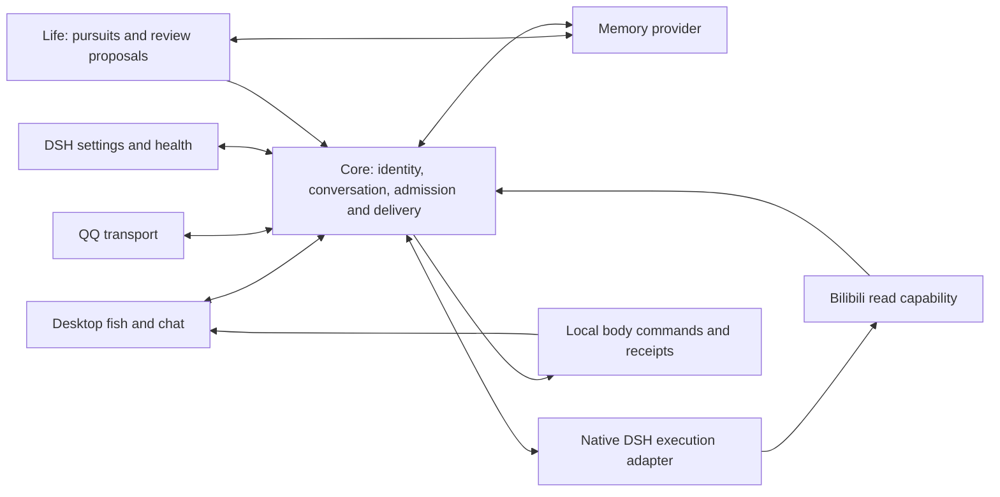

# Codex-Pet Development Plan

- Revision: v0.3.
- Prepared: 2026-11-04, Asia/Ho_Chi_Minh.
- Status: Complete planning and type-only interfaces; business implementation and runtime validation pending.
- Authorization: The user requested a development outline, then asked us to draft
  the proposed Stage 0 package, then required full planning and reserved module
  interfaces even where module development is deferred.
- Current stage: Stage 0, pending review and resolution of the choices below.

## Purpose And Source Ownership

Turn the retained design into a sequence of complete, verifiable product flows.
This file owns development sequencing, proposed work packages and acceptance
gates. It does not establish that the proposed architecture works or that its
technical choices have been accepted.

| Source | Responsibility |
| --- | --- |
| [Repository README](../../README.md) and [setup record](../setup.md) | Current preparation and environment status |
| [Product plan v0.9](plan.md) | Confirmed product outcome, reviewed boundary repairs and open product choices |
| [Module design v0.3](modular-design.md) | Module dependencies, sole writers, Core resource/maintenance facets and lifecycle contracts |
| [Module contracts](module-contracts.md) and [type skeletons](../../src/contracts/index.ts) | Complete public interfaces, absence/compatibility semantics and deferred-module integration |
| [Reference study](reference-study.md) and [source manifest](../../references/manifest.json) | Research applicability and exact local source identities |
| [Current handover](../handover/README.md) | Work checkpoint, uncommitted scene and restart action |

The target repository now exists at the path in the repository README. Statements
about an unchosen destination in the retained baseline describe its earlier
planning context. No original snapshots are changed by this development draft.

## First Complete Release

Deliver a locally running DSH-backed companion with one continuing identity:

- A blue fat fish on the Mac desktop, compact chat and a recent-life view.
- Persistent conversation, relevant recall, correction, forgetting and readable
  memory/source inspection across execution-session replacement and restart.
- Ordinary QQ owner private chat continuing the same conversations and matters.
- At least one concrete assistance flow with an outcome, progress and recovery.
- Autonomous Bilibili activity that produces attributable experience and can be
  interrupted, paused, bounded and selectively shared.
- A coherent settings/health entry, installation, backup and recovery route.

The intermediate milestones accumulate toward this release. A milestone's
limited interface does not remove the remaining product goals.

Planning covers every module now. Each has operations, data ownership,
dependencies, absence behavior and an integration gate in the module contracts.
Implementation scheduling may defer a provider; its interface and planned
responsibility remain in scope. No deferred module is considered ready.

Propose compact recent-life presentation for the first release. The expanded
room interface is planned now as a Desktop sub-capability; its renderer/content
implementation and release timing remain open. Autonomous life remains in scope
with either choice. Voice, public/group social behavior, mobile access
and server hosting stay outside the currently selected first-release scope.

## Everyday Experience To Review

| Situation | Proposed interaction | Evidence and exception visible to the user |
| --- | --- | --- |
| Start or resume DSH | The supervised fish appears and restores its current situation; clicking opens compact chat | A disconnected or recovering state is visible; startup does not create a new identity |
| Continue through QQ | Start a topic on desktop and continue it in owner private chat | Relevant context and unfinished matters persist; source channel and reply association remain recorded |
| Remember or correct something | State an agreement naturally; later correct it or request forgetting | Memory inspection shows the applicable fact and source; unrelated memories remain available after a failed operation |
| Assign useful work | Ask for a bounded comparison or explicitly assign a matter | The fish retains the requested outcome, next step and waiting reason; completion depends on the result |
| Leave it unoccupied | It chooses exploration, continuation, reflection or rest | The life view distinguishes its intention, actual activity and resulting experience |
| Return during exploration | Ask a question or give an assignment | Owner conversation takes priority; interruptible work checkpoints, and an unavoidable current call is reported accurately |
| Ask what it learned | It discusses an actual source or completed virtual activity in ordinary language | Sources and reading coverage are inspectable; incomplete content is described as partial |
| Need quiet or a break | Quiet suppresses unsolicited contact; autonomy pause stops new autonomous work and requests cancellation/checkpointing of current work | Owner conversation remains available; actual stop status is shown |
| Sleep, close DSH or restart | Work stops with the selected local lifetime and resumes from recorded state | Interrupted owner matters are surfaced; missed autonomous opportunities are reassessed without an offline diary or notification burst |

Propose three candidate assistance cases for scope selection: retaining and
recalling an agreement, comparing specified material, and following up an
explicitly assigned matter. All three use the planned Core commitment and
result/source contracts. The first implementation can cover one complete case;
the other cases retain their interfaces. Calendar, email and unrelated
application access are not implied by them.

## Carrier And Responsibility Proposal

Use the module contracts in [modular-design.md](modular-design.md). The working
carrier is one DSH bundle with addressable Cordis entries, supervising one Mac
helper and, if selected, a local memory service. Initial modules release together.

Arrows show logical requests and results, not plugin activation dependencies.
Providers register through Core's public boundary; Core does not import their
implementations to start. The declared dependency graph remains in the module
design. No additional assistant runtime, plugin loader or generic bus is proposed.

### Data Ownership And Boundaries

The module design owns the full ownership contract. These are the implementation
records that the proposed flows require; names and storage bindings are provisional.

| Record | Sole owning writer | Important links or constraints |
| --- | --- | --- |
| Companion identity, owner/channel bindings | Core | Stable companion ID independent of DSH session and gateway login IDs |
| Presented conversation, owner commitments | Core | Original channel message ID, host turn reference and requested outcome; native execution logs stay with DSH |
| Admitted activity, execution and contact intent | Core | Stable request/source IDs, checkpoints, bounded work and durable outcome reconciliation |
| Evidence, temporal claims, derivations and withdrawals | Memory | Attributed sources and revisions; correction/forgetting invalidates dependent recall and diary views |
| Immutable original input/action evidence | Core | Processing/audit port only; Memory owns its mirror's eligibility versions |
| Artifact bytes/catalogue/retention | Core resources | Scoped upload/read/holder ports; derived access requires eligibility leases |
| Export/backup/restore transactions | Core maintenance | Durable operational ledger and per-owner import permits; independent of Console |
| Self-chosen pursuit, next check-in and review proposal | Life | Core admits execution and contact; replacing a schedule does not discard an unfinished matter |
| QQ connection and transport receipts | QQ | Core's contact ID links gateway confirmation, failure or unknown outcome; no blind resend |
| Read result and modality/coverage | Bilibili | Returns source-linked evidence through Core; no independent memory writes |
| Body state and action receipt | Desktop | Local continuous animation; completed virtual action distinct from an external action |

Contact attempts freeze channel binding revision, account and recipient before
send. Conversation/context/life/artifact views retain dependency stamps and use
leases; an event is not their authority. Core operational/resource/backup and
actual-outcome ledgers are protected from companion-domain restore. Restore
merges current withdrawals, advances the Memory epoch and revalidates readiness.

Other modules use explicit operations or rebuildable views. A separate memory
Bank has one writer and its own migration owner. Core's durable processing work
and provider acknowledgments need idempotency and reconciliation across stores.
UI and console changes invoke the same application operations as tools.

### Product Interfaces Now, Host Mappings After Inspection

The families below are specified by [module-contracts.md](module-contracts.md)
and `src/contracts/`. Installed SDK inspection verifies their host mappings; it
does not postpone the public contract of a deferred module.

| Interface family | Contract questions to settle |
| --- | --- |
| Incoming conversation and presented result | Actor/owner validation, channel provenance, duplicate input, ordering, correlation and visible reply routing |
| Native execution request and outcome | Session binding, logged context, allowed tools, cancellation, bounded background work and host event references |
| Memory observation, proposal, commit and recall | Scope, evidence class, expected revision, stale result, withdrawal, truncation and acknowledgment |
| Activity proposal, admission and receipt | Ownership, available capability, stopping condition, checkpoint and restart reconciliation |
| Contact intent and transport outcome | Eligible channel, stable intent ID, attempted send, confirmed/unknown/failed result and recovery |
| Helper command, receipt and snapshot | Protocol version, boot identity, reconnect state, started/completed distinction and process lifetime |
| Configuration and health | Available capability, effective settings, incompatibility and concise failure/waiting reasons |

All families need explicit input/result/error, scope, compatibility and
idempotency rules. Cancellation semantics apply where work can be in flight.
SDK-facing adapter mappings depend on installed host inspection in Stage 1.
Changes to product semantics require an explicit contract revision and consumer
review rather than an implicit SDK-driven rewrite.

## Running, Stopping And Recovery

1. **Start:** Validate configuration and compatible contracts; open owned state;
   register Core services; let providers activate through host dependencies;
   reconcile unfinished work before autonomous dispatch; supervise the helper.
2. **Owner input:** Attribute and deduplicate it, persist the accepted input,
   serialize state-changing owner turns per companion, assemble scoped context,
   execute through DSH, then record the presented result and memory processing work.
3. **Autonomy:** Life proposes a pursuit/check-in. Core checks current commitments,
   pause state, capability, permissions and resources before durable admission.
   Execution produces evidence; memory processing and optional contact follow.
4. **Interruption:** Stop admitting more background steps. Request supported
   cancellation or checkpointing and record what actually stopped. Concurrent
   read-only work is conditional on verified host support and scoped results.
5. **Shutdown:** Close admission, cancel/checkpoint owned work, record uncertain
   outcomes, dispose subscriptions/tools/timers and terminate supervised helpers.
   An external request already accepted may remain uncertain until reconciliation.
6. **Resume:** Reconcile host execution and transport evidence; retain unresolved
   owner commitments, reassess expired autonomous check-ins once, and restore a
   presentation snapshot. Package rollback must respect state/schema compatibility.

Quiet and autonomy pause have separate meanings. Autonomous reading, extraction,
review and outreach share bounded resource admission, while owner conversation
retains separately managed capacity. Before live autonomous checks, configure
finite run/time/tool/concurrency limits and a contact policy. Exact values are
open. Delayed usage/pricing cannot support a claimed exact monetary cutoff.

Missing Memory pauses dependent recall/writes and derived disclosure while
accepted sources wait durably. Owner conversation uses only verifiably clean
context; rebind/reproject or report blocked when old native memory cannot be
validated. Losing QQ, Bilibili or Desktop degrades that capability. Losing Core stops
dependent product work. No failure creates a replacement identity or Bank.

## Choices To Resolve

These recommendations carry forward existing candidates; they are not a fresh
compatibility assessment. Stage 1 must compare only what is necessary to resolve
an identified gap and record exact tested versions.

| Choice | Proposed starting direction | Evidence needed / change condition |
| --- | --- | --- |
| Host and packaging | Native DSH adapter and one bundle with multiple entries | Inspect installed contracts, lifecycle and packed files; revise bindings if required behavior is unavailable |
| Mac shell and rendering | Test Swift/AppKit first; add a mature local renderer only for selected chat/body needs | Transparent window, Chinese input, focus, click-through, multiple displays, scaling, accessibility and sleep/wake with intended assets; compare alternatives if a required interaction fails |
| State and memory | Evaluate SQLite for application state and selective Mnemosyne adaptation versus a smaller owned memory provider | Transactions/binding on the selected runtime; corrections, withdrawal, recall, service supervision and migration against the same cases; choose one provider for integration |
| QQ transport | Evaluate ordinary-account OneBot/NapCat route | Supported local operation, account coexistence, controlled owner exchange, reconnect and unknown-send recovery |
| Bilibili connector | Reuse a compatible established content capability | Subtitle, no-subtitle and visual-heavy cases; report actual modalities, gaps, dependencies and account requirements |
| First presentation | Fish, compact chat and recent-life view; room interface already reserved | Review room renderer/content timing and maintenance impact; later implementation uses the same body and memory boundaries |
| Character and assistance | Preserve one editable identity; select a concrete assistance case | Agree initial character/relationship and the expected useful output before writing behavior rules |
| Operating policy | Separate quiet/pause, bounded autonomy and one eligible proactive outlet | Set resource/contact limits, Bilibili account/feed scope and backup retention before the relevant live checks |

## Development Sequence

All stages below are proposed. Complete planning and interface skeletons are the
current authorized work. No business module, account connection or live probe
has been implemented or executed for it.

| Stage | Work package and reviewable result | Exit condition |
| --- | --- | --- |
| 0: Overall design and interfaces | Complete flows and module catalogue, public type contracts, deferred-provider behavior, choices, validation and release cases | Every planned module has a concrete contract now; record reviewed direction and choices needing Stage 1 evidence |
| 1: Critical validation | Bounded DSH, Mac, memory/state, QQ and Bilibili probes; versioned results and component decisions | Required flows have local evidence or an explicit revised route; unresolved failures block only dependent implementation |
| 2: Product foundation | Bundle/module lifecycle, stable identity, DSH adapter, owned persistence and durable work/receipt boundaries | Start/stop/restart preserves identity and pending work; optional dependency loss is explicit; no orphaned work |
| 3: Desktop and memory | Fish/chat, native turns, recall, correction/forgetting and one selected assistance flow | Continued conversation survives rebind/restart; useful assignment result and memory changes remain inspectable |
| 4: QQ continuity | Owner binding, two-way text, cross-channel continuity and transport recovery | Actual owner exchange, dedupe and correction work across entrances; uncertain send is handled without duplicate intent |
| 5: Autonomous life | Pursuit/check-in, real bounded Bilibili activity, evidence ingestion, optional share and control policies | Interruption, quiet/pause, resource exhaustion and restart preserve truthful activity and memory state |
| 6: Daily use and maintenance | Unified settings/health, installation artifacts, export/backup/restore and normal-use observation | Release cases pass and the user assesses continuity, usefulness, life rhythm and attention burden |

Treat stop/restart, error handling, diagnostics and data recovery as part of every
feature's completion. Stage 6 integrates their operational experience.

Stage 1 DSH/state work informs Stage 2. Mac validation informs Stage 3; QQ and
Bilibili viability must be investigated early even though their product flows
are integrated later. A user-dependent login can remain pending while unrelated
probes advance, but it cannot be reported as a passed integration gate.

Estimate implementation work after Stage 1 exposes binding, packaging and
dependency costs. Track remaining uncertainty rather than assign dates from
source availability or upstream screenshots.

## Stage 1 Validation Packages

Each package records the case, exact versions, initial state, limits, procedure,
observations, result, artifacts and cleanup. Use disposable companion data and
existing local sources; do not execute upstream setup/build hooks to read them.
Account login/QR steps remain operator actions at the relevant test.

| ID | Smallest useful check | Required evidence / failure consequence |
| --- | --- | --- |
| V1 Host | Inspect installed services; exercise one bound native turn, logged context, bounded work, interrupt and restart | Source/signature pointers plus actual host events; revise the adapter or scheduling design for missing guarantees |
| V2 Mac | One shell with fish/chat and intended asset format across input, displays and sleep/wake | Observed interaction, limitations and measured idle/active resource use; change shell before expanding the UI if required cases fail |
| V3 Memory/state | Use attributed inputs to test paraphrase recall, source inspection, late correction, forgetting/re-ingestion and pending-work restart | Results for the same frozen cases across provider candidates, including cross-store recovery; no autonomous enduring writes until correctness is established |
| V4 QQ | Controlled owner text exchange, replay/reconnect and send with uncertain outcome | Actual gateway/message evidence and available reconciliation limits; revise local transport route before claiming continuity |
| V5 Bilibili | Inspect a bounded representative set covering subtitle, no-subtitle and visual-heavy content | Source/time coverage, actual inspected modalities, gaps and resource/dependency requirements; unsupported methods remain explicit |
| V6 Lifecycle | Exercise a disposable host plugin/provider probe: disable/re-enable, dependency loss and absent optional SDK | Host cleanup and capability transitions are observable; repeat against actual product modules from Stage 2 onward |

Read-only contract inspection can precede live tests. Before executing live
checks, establish the test scope, account involvement and finite resources in
the relevant work package. This draft does not mark any validation package passed.

## First-Release Acceptance Cases

These are draft specifications, not completed tests. Before each run freeze the
inputs, expected observations, versions, resource/stop limits and intervention
record. Capture failures as well as successes. Fixture checks and real model,
gateway, UI and user observation provide different evidence.

| ID | Whole-flow case | Required observation |
| --- | --- | --- |
| A01 | Desktop conversation, compaction, session replacement and restart | Identity, relevant agreements and presented conversation persist without routing to an unrelated session |
| A02 | Continue desktop topic through QQ, then correct it there | Both entrances reflect the same applicable context; original channel/actor attribution survives |
| A03 | Apply a new correction while an old extraction is pending | Late work cannot restore the superseded fact; unrelated valid memory remains readable |
| A04 | Forget a source, then replay/re-import it and recall a derived diary passage | Withdrawal rules prevent prohibited recall/re-derivation; native-log deletion remains a separate explicit operation |
| A05 | Complete the selected assistance case and interrupt/restart midway | Outcome, next step and waiting state survive; completion is supported by the requested result |
| A06 | Autonomous Bilibili read with missing or partial content | Actual source and modality coverage support what it says; no invented audiovisual understanding |
| A07 | Owner message during exploration; activity finishes early or reaches a limit | Owner gets timely handling within measured host constraints; no extra background dispatch after pause/exhaustion |
| A08 | Quiet, autonomy pause, sleep/shutdown and resume | Expected distinction between contact and execution; no offline experiences, stale wake backlog or duplicate share |
| A09 | QQ send times out after possible acceptance; gateway reconnects | Outcome stays unknown until supported reconciliation; stable intent is not blindly resent |
| A10 | Disable modules, remove optional SDK, lose provider or use incompatible helper | Clear degradation, preserved data and no residual owned process/timer/tool after stop |
| A11 | Crash between intent and receipt; interrupt migration; restore a backup | Recoverable pending work, no duplicate memory source, and preserved identity/correction/withdrawal state |
| A12 | Feed external content containing instructions; use a bounded reader | Content remains evidence rather than owner authority; tool exposure and private context remain within configured scope |
| A13 | Install packaged artifacts and observe ordinary daily use | Required files are present; Chinese input/display behavior, health and recovery are usable; costs/resource use and attention burden are recorded |
| A14 | Leave a planned provider absent, then add a compatible implementation | Capability is truthfully `not_implemented` before integration; callers receive explicit unsupported results; later binding preserves existing consumer contracts and owned data |
| A15 | Withdraw/correct a source after a context/life/history/artifact view is cached, lose events, then try to use it | Synchronous eligibility and bounded use admission reject invalid dependencies; in-flight uses are tracked; no completed withdrawal is claimed while conflicting uses are unresolved |
| A16 | Rebind the QQ account/owner while a send is queued or uncertain | New send rejects the old target; reconciliation and late receipts remain tied to original binding/account/recipient without blind resend |
| A17 | Inspect/withdraw an observed source before extraction, or tombstone a not-yet-observed source | Source revisions are queryable; null precondition is atomic; late observe/commit is blocked and unrelated memory stays readable |
| A18 | Upload/resolve/export artifacts, cross a scope, release holders, and restore onto preserved resources | Core alone owns bytes/catalogue; access/digest/retention checks apply; derived bytes cannot bypass leases or be silently restamped |
| A19 | Disable Console and crash during Core-domain/Memory restore from an old backup | Core transaction/receipt/resource ledgers survive; current withdrawal guard is preserved, old epochs invalidated, and partial or unknown imports do not resume mixed state |

The five review repairs map to A15–A19 and to compile-only examples in
`scripts/contract-types.mts`. Static checks cover interface shape and ownership;
the cases above remain required runtime/provider evidence. In particular, V3
must exercise lease/withdrawal races and source versions, V4 binding changes,
and V6 Console-independent restore/control-port lifetime and optional services.

A successful release needs the complete flows, operational evidence and user
assessment. Type checking, source downloads and upstream maintainer results do
not establish that outcome.

## Stage 0 Review And Next Work

Review this draft in the following order:

1. Review complete planning coverage and concrete interfaces for every module,
   including room and all assistance cases; choose implementation/release order.
2. Review the proposed carrier, module/data ownership and lifecycle boundaries
   against the existing module design. Record amendments in their owning sources.
3. Resolve which choices need user preference and which Stage 1 can settle with
   evidence; set the relevant resource/contact and account-test scope.
4. Turn V1 into the first bounded validation work package, beginning with
   read-only installed DSH contract inspection and defining the subsequent live
   test before execution. Keep V2–V6 visible as dependencies of the full release.

This task delivers complete planning and compile-checked interface skeletons.
The user's requirement to reserve interfaces is recorded as confirmed. Specific
contract acceptance, Stage 1 execution and provider choices remain distinct from
that requirement; no business implementation is reported complete.
