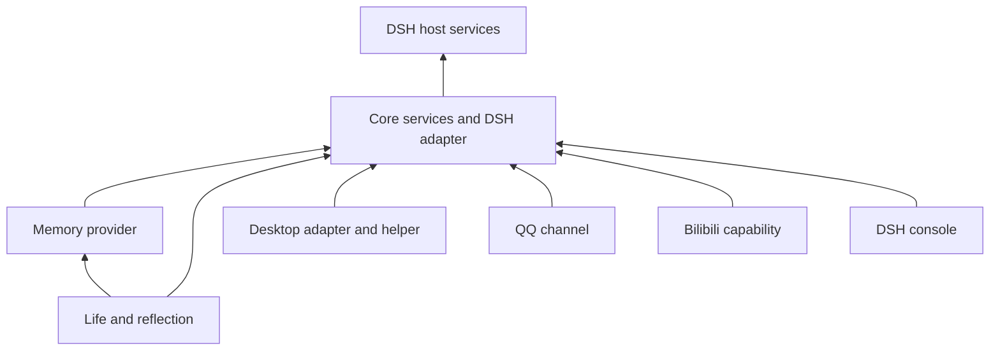

# Dafeiyu Modular Design

- Revision: v0.1, accompanying [plan v0.7](plan.md).
- Date: 2026-11-04; client timezone Asia/Saigon.
- Status: Architecture proposal. The user requires modularity and prefers native
  DSH plugin integration. Module boundaries below remain proposed.
- Ownership: This file owns the proposed module/dependency, lifecycle and
  maintenance contracts. The plan owns product scope and open decisions;
  [reference-study.md](reference-study.md) owns source applicability.

## Packaging And Host Direction

Recommend one target-product source repository, one initial DSH distribution
bundle, and multiple addressable Cordis plugin entries within it. Keep the Mac
helper and any local memory service under the corresponding module's supervision.
Use DSH/Cordis services, dependency injection, events, configuration and cleanup.
Do not create another plugin loader, generic event bus or Agent runtime.

A business module is an ownership and contract boundary. A Cordis plugin entry
is a host activation unit. A bundle is an installation/release unit. A process
is a runtime isolation/lifetime boundary. These do not need a one-to-one mapping.
The desktop module can have Host, DSH Client and native-helper artifacts while
remaining one capability to maintain.

Initial modules release together under one compatible bundle version, with a
single lockfile and explicit build/packed-artifact checks in the future target
repository. Extract separate packages only when independent reuse, dependency
weight or release cadence justifies the added compatibility work. Do not require
the user to assemble a compatible set of separately published packages.

## Module Responsibilities

The labels are proposed logical names, not registered package/service IDs.

| Module | Owns | Required collaborators and boundaries |
| --- | --- | --- |
| Core and DSH adapter | Stable identity/bindings; owner conversation/commitments; native execution entry; common activity dispatch, permission/resource checks and delivery coordination | DSH Agent/session/tool contracts. Publishes narrow product services; does not import QQ, Bilibili or desktop implementations. |
| Memory | Evidence, temporal state, recall/context proposals, correction/forgetting, derivation status and Bank migrations | Core supplies attributed sources and scope. The selected provider is the only memory writer. Mnemosyne can be an implementation behind this contract. |
| Life | Self-chosen pursuits, next check-in, review, curiosity and reflection proposals | Core is the only dispatch/contact gate. Memory is accessed through its service. No independent model client or timer may bypass common controls. |
| Desktop | Pet/body actions, chat transport, native-helper lifetime and presentation state | Core supplies conversation and real activity state. UI never writes memory or owns a second conversation model. Native helper protocol is versioned. |
| QQ | Gateway connection, explicit owner-account mapping, incoming normalization and transport receipts | Core supplies reply/contact intent. Gateway is external transport; no own persona/memory/scheduler. SDK is optional and loaded only when enabled. |
| Bilibili | Discovery/read capability, evidence/coverage and bounded reader integration | Core dispatches authorized work; Life or an owner request supplies its purpose. No hidden auto-browse loop, social writes or second memory authority. |
| DSH console | One localized settings/health entry with memory, life and connection views | Reads available services and invokes their application operations. Missing optional modules remain visible as unavailable without activating their SDKs. |
| Shared contracts library | Public domain types, interface/error/version definitions and pure validation | Compile-time/runtime support, not a separately running plugin. No service, filesystem, timer or secret side effects at import. |

Assistance commitments initially live in Core because every entrance and activity
must respect them. Split a dedicated assistance module only when concrete duties
justify independent ownership; do not pre-create a generic workflow framework.
Association/attention experiments belong behind Memory's recall boundary;
curiosity candidates belong behind Life's proposal boundary. The whitepaper's
full graph/neuro-modulation stack is not a mandatory module set.

## Dependencies And Public Contracts

Arrows mean declared service dependence, not direct imports or call direction.
Providers register capabilities with Core; Core does not depend on them to start.
Life waits for its required memory service. The console observes optional services
reactively. Shared contracts are an acyclic library dependency of each module.

Use service calls for requests needing a result; use typed events for observations
and notifications. Cordis events handle live coordination. Durable messages,
activity intents, receipts and memory work use the owning store/outbox and stable
IDs; an emitted event is not proof that a consumer processed or persisted it.

Public operations need explicit input, result/error, scope, cancellation,
idempotency and compatibility semantics. Cover at least:

- Attributed incoming message and conversation result, with source/actor/channel.
- Memory observation, recall/context result, change proposal and committed result.
- Activity proposal, admitted execution, checkpoint/cancel and outcome receipt.
- Proactive contact intent, selected channel and transport delivery outcome.
- Body command, accepted/started/completed outcome and current presentation snapshot.
- Health/configuration operations shared by tools and UI.

Separate internal contract version, persisted schema version, helper protocol and
external API version from the initial bundle release version. A required mismatch
blocks that capability with a clear reason. No fallback to another companion,
session, Bank or gateway identity. Do not infer compatibility from matching names.

## Data, Context And Authority

Each durable record has one writer and schema/migration owner. Core owns product
identity, conversation presentation, admitted activity/commitment and delivery
coordination records. Life owns its proposals and review state; Memory owns
evidence/judgments and withdrawal state; a channel owns transport details. Link
them through stable source, request and receipt IDs. Other modules use public
operations or rebuildable views, not private tables or another module's files.

DSH remains authoritative for native execution/session events. Reuse committed
events and supported projections; do not append new unrecognized event types or
replace global prompt/compaction behavior. Model-visible context must enter via
supported logged mechanisms so resume/replay retains its provenance. The exact
installed APIs require live inspection before implementation.

A selected separate memory service owns its Bank; the adapter does not write its
SQLite database directly. Cross-store commits use durable, idempotent work and
reconciliation. Source correction/withdrawal invalidates derived recall and views
through the owning API. Transport retry cannot create a second memory source.

A Cordis service dependency is not an access-control sandbox. Host plugins share
the host process and execute with host-level capabilities. Declare trust and tool
exposure explicitly; enforce permission/budget/state changes in code. An actual
process, filesystem or credential boundary needs separate implementation evidence.
Secrets, paths, account IDs, ports and run bindings come from trusted configuration.

## Activation, Failure And Stop

DSH loads the bundle's declared rows. Dependencies activate through services;
subscriptions, tools, UI registrations, timers and child handles belong to the
module's effect lifecycle. Do not use hidden module-import side effects or manual
boot delays. Stopping/disabling a capability stops new admission, checkpoints or
cancels in-flight work as supported, drains/records uncertain outcomes, removes
registrations and releases owned resources. It does not erase durable state.

| Capability unavailable or disabled | Intended degraded behavior |
| --- | --- |
| Core | Dependent product capabilities stop; no orphaned helper or independent life loop continues. |
| Memory | Conversation may continue with an explicit unavailable state and current native context; dependent autonomous recall/writes pause. Already recorded sources wait durably for processing. No fabricated memory or new replacement Bank. |
| Life | Owner conversation, assistance and memory remain usable; autonomous check-ins/review cease. |
| Desktop | QQ/DSH entrances remain available when otherwise healthy; restarting the helper restores a snapshot without replaying stale decorations. |
| QQ | Desktop/DSH remain usable; uncertain sends remain uncertain and are not blindly resent. |
| Bilibili | Browsing-dependent activities wait, fail or choose rest; other conversation/assistance continues. |
| DSH console | Runtime state is retained; supported host controls remain available. Console failure must not start a second runtime. |

These are product requirements to verify, not guarantees provided automatically
by Cordis. A guarded operation failure can degrade locally; an in-process fatal
error can still affect the host. Use child processes only for a concrete native
capability, dependency or fault-isolation need, with health and lifetime handling.
No module continues autonomous model/network work after the product/DSH stop.

## Upgrade And Maintenance

Declare a tested DSH version range, host platform, dependencies and display
resources. Use the supported Plugin Manager bundle workflow at implementation
time. Keep agent behavior scoped to the companion/workspace even though package
installation is profile-wide. Do not edit DSH application files or replace its
bundled dependencies; the current planning work changes neither.

Do not promise code hot-swapping: some configuration changes can apply live;
replacing installed JavaScript or native binaries may require restart. Stop and
drain affected work, back up owned state, run explicit schema migrations and
verify readiness before resuming. Never run old and new writers on one Bank.
Code rollback is separate from data rollback; incompatible schema changes need
a tested recovery path and must preserve later unrelated user data.

Disabling, uninstalling and erasing data are separate operations. Retain personal
memory/history by default on module removal, explain what stopped, and make data
deletion a separate user-visible operation. Removing the full bundle must stop
owned processes without silently deleting or migrating the companion's data.

Before claiming modularity, verify: optional SDK absence; disabling each module;
dependency loss/recovery; duplicate events; interrupted migration; restart between
intent and receipt; incompatible provider/helper versions; memory-provider
replacement with correction/forgetting intact; and no residual timer, listener,
tool, process or outbound retry after stop. Also check the installed/packed file
list so a linked checkout cannot hide missing release artifacts.

## Decision Status

Modularity is a confirmed requirement. Native DSH plugin integration is the
preferred route and has documentary support. One bundle, the proposed plugin
boundaries and failure policies are recommendations for this planning revision.
The installed DSH 0.2.1-rc.5 documentation and official sources were inspected;
no live API inspection, activation toggle, package build, profile mutation,
account connection or modularity test was performed. Target repository location,
memory provider, Mac toolkit and final public signatures remain open.
