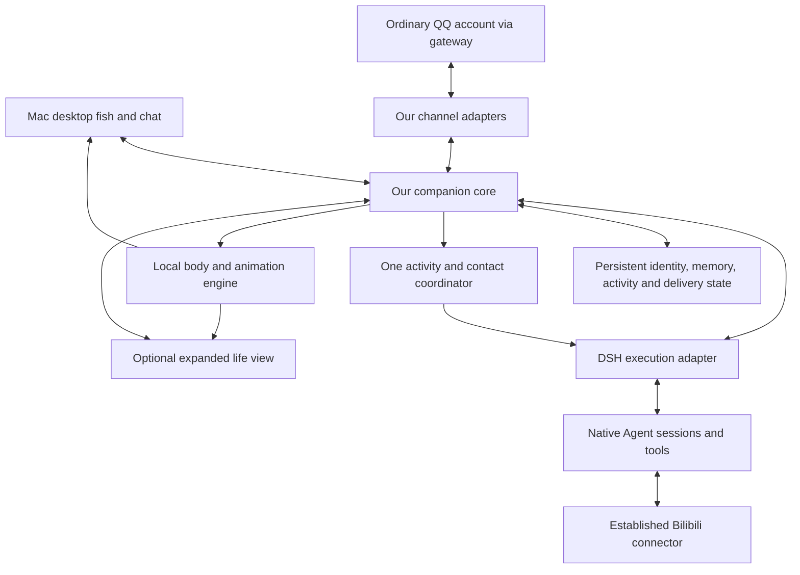

# Project Plan: DeepSeek Harness Dafeiyu

- Project ID: `dsh-dafeiyu`
- Revision: v0.7 — modular architecture and native DSH packaging
- Prepared: 2026-11-04, Asia/Ho_Chi_Minh
- Status: Overall-design proposal; implementation and acceptance remain open
- Current work: Consolidate final planning, starting with module and maintenance boundaries; no target implementation.
- Continuity: This plan, the [module design](modular-design.md), and the [reference study](reference-study.md).
- Previous proposal: [v0.6 snapshot](snapshots/plan-v0.6.md), with earlier revisions retained under `snapshots/`.

## Direction And User Correction

Build a new, coherent DSH-backed Dafeiyu personal companion/assistant. The user
explicitly corrected the previous approach: existing plugins are references for
our design and implementation, not the deliverable installation combination.
The previous preferred-plugin bundle and single-session-centered architecture
are therefore superseded proposals, not accepted baselines.

Own the product's persistent identity, memory semantics, activity coordination,
interaction and operating experience. Keep DSH as the execution/model host;
use established libraries and external gateways for solved capabilities. This
direction does not require implementing a new LLM runtime, QQ protocol, database
engine, or animation framework.

Combine the four requested references (SurfCore, surfpet, QCYTSN/dsh-dafeiyu,
and dsh-dafeiyu-room) with the earlier companion, memory, heartbeat, Bilibili,
QQ and desktop references, plus the user-confirmed canyueY/Mnemosyne 2.0 for
memory and chenkezhen480/dsh-world for activity. The [reference study](reference-study.md) owns their
identities, inspected evidence and applicability limits. References inform our
decisions; a feature list or an upstream default does not become our requirement.

## Synthesis And Main Design Decisions

The recommendation remains one DSH-hosted companion core and a supervised Mac
client. This revision adds explicit assistance commitments, evidence-based
interest development, bounded context construction, and a common execution and
delivery record. v0.6 further distinguishes observation from judgment, current
state from history, and self-chosen plans from infrastructure wake-ups. These
connect companionship, useful help and autonomous life.

| Reference strength | Our decision | Tradeoff or limit |
| --- | --- | --- |
| SurfCore's shared character and purpose ownership; hub/AstrBot companion continuity | One durable identity with separate owner commitments and the fish's own interests | Do not collapse continuity into one execution session, or turn every autonomous choice into a user task. |
| surfpet's thin presentation; fish-buddy's native-session input; dot's integrated settings | Desktop and QQ enter the same core and native DSH Agent path | Rich chat costs more than a separate lightweight persona call; measure before adding another path. |
| QCYTSN's supervised helper; Fidget and room's local body execution | Keep continuous movement local; request model decisions only for consequential choices | Native windowing and rich rendering must be tested together; a desktop pose is not evidence of external work. |
| fish-memory's time/correction; plugin-memory's inspectable knowledge; dot's source and forgetting controls | One source-backed memory lifecycle, readable views and on-demand detail | Different evidence classes are necessary: dot's user-text-only policy alone cannot represent autonomous experience. |
| heartbeat's silent signal checks; speak-up's native follow-up | Cheap local checks offer opportunities to one coordinator; meaningful context opens an Agent turn | A random wake-up is not a motive; a heartbeat task snapshot is not a durable commitment store. |
| bili-subagent's internal reading reports; whale/pond's personal experience; retrieval tools' source coverage | Tools gather evidence, optional workers read bounded material, the companion interprets and chooses whether to share | No parallel persona, independent timer or automatically published report. |
| QQ link/bridge/dot routing and delivery patterns | Explicit owner binding, incoming-message dedupe and durable outgoing delivery state | Gateway acceptance is not proof that the user read a message; unknown outcomes require reconciliation. |
| AIRI's body/audio/domain separation; MaiBot's social-presence direction | Keep embodied expression extensible and allow natural silence | Voice, Live2D/3D, group social life and a second Agent platform are not selected scope. |
| Mnemosyne 2.0's evidence, temporal claims, derivation and feedback boundaries | Preserve changing state and invalidate dependent conclusions when their sources change | Saving, ranking, repeating or liking a memory does not verify it. Its full cognitive rule engine is not our companion's semantic planner. |
| dsh-world's home, self-scheduled next step and daily review | Let the companion propose its own next activity/check-in; the common coordinator validates and schedules it | A scheduled wake is neither work completed nor user speech. Keep program-enforced limits rather than copy its advisory daily-budget reminder. |

These lessons converge on our core contracts: what belongs to whom, which action
actually happened, what can be remembered, and when a useful result should reach
the user. Each capability participates in that same lifecycle.

## Confirmed Outcome And Boundaries

The user wants a blue fat fish desktop companion with persistent chat, a memory
system, an ongoing life including autonomous Bilibili activity, and its own
ordinary QQ account through which the user can chat as a normal friend. The user
has a small QQ account available. The Mac and DSH run it locally; shutting down
the Mac stops activity. Server hosting and official QQ bot identities are outside
this selected operating model.

The user now requires a modular product and prefers DSH-native plugin integration
to simplify maintenance. Modularity is confirmed; the proposed module boundaries
and packaging in [modular-design.md](modular-design.md) are not yet accepted.
This final-planning phase consolidates choices and verification obligations;
it does not reopen reference collection or begin target implementation.

The corrected build direction is confirmed. The architecture, toolkit, storage
binding, model choices, life behavior and visual treatment below are proposals.
Referencing a room project does not by itself confirm a full room/game feature.
No inherited maid persona, mood formula, relationship score, mobile client,
public social activity or old local-chatbot data is selected automatically.

Private-assistant duties still need concrete user scenarios. Proposed examples
are remembering agreements, helping organize information, and following up an
explicitly assigned matter. We should define those alongside companionship,
rather than claim that browsing and casual chat alone establish assistant value.

## Intended Experience

The desktop fish is the everyday presence. Clicking it opens a compact chat;
folding that chat leaves the companion running. QQ is another entrance to the
same relationship. The user can continue a topic, correct a fact, or ask what the
fish has been doing without knowing which DSH execution session is active.

When unoccupied, the fish may pursue an interest, explore Bilibili, continue an
unfinished activity, interact with its virtual environment, or rest. It can later
discuss an actual experience with its source and coverage. It shares selectively,
with a way to become quiet without losing memory or breaking normal replies.

A proposed expanded life view can reveal a room, current activity, recent
experiences and ongoing interests. It is a view of the companion, not a second
character or another memory system. Whether this view is part of first delivery
or a later presentation decision remains open; autonomous life itself stays in
scope either way.

The visual language must distinguish:

- actual external activity, such as reading a video transcript or sending a QQ reply;
- executed virtual-world activity, such as sitting, making tea or sleeping in a room;
- decorative animation or offline display;
- intentions and plans that have not completed.

Virtual experiences can belong to its life, but must retain their virtual-world
provenance. A reading pose cannot prove that an external video was understood.
An offline sleeping picture cannot claim model activity during shutdown.

### Representative Whole Experiences

These scenarios are proposed acceptance cases, not records of completed use.

| Situation | Intended experience | Required continuity or exception |
| --- | --- | --- |
| Continue a desktop topic through QQ | The fish understands the topic, relevant agreement and current progress without asking the user to copy a transcript | Shared history and recall preserve channel provenance. Concurrent inputs are ordered or reconciled, not answered from two silently divergent states. |
| Ask for help while it explores Bilibili | It acknowledges the request, pauses or checkpoints interruptible exploration, and handles the assignment | An uninterruptible tool call may finish, but it must not start further background steps or claim cancellation already succeeded. |
| Ask what it has been doing | It can discuss a real video, an unfinished inquiry, a completed virtual activity, or having rested | Reading coverage and source are inspectable; an ordinary reply need not sound like an execution log. |
| Correct a preference after a QQ conversation | The correction applies on desktop and to future activity choices | A queued old extraction cannot restore the old preference; failed updates do not hide unrelated memories. |
| Return after Mac sleep or shutdown | The fish resumes its known situation and can explain any interrupted matter | It has no invented offline diary, overdue autonomous-turn backlog, or promise that it could deliver reminders while off. |

The proposed everyday surface is a small desktop fish, a compact chat, and an
expandable recent-life view. Right-click or the shared settings entry exposes
quiet/focus, autonomy pause, memory inspection and health. Normal use should not
require switching DSH sessions, reading reports in directories, or operating a
second administration panel. A room can later enrich the life view without
changing its underlying identity, activity or memory contracts.

## System Responsibilities

| Responsibility | Our product owns | Reuse or boundary |
| --- | --- | --- |
| Persistent companion | Stable identity, relationship, persona revisions, scene mappings and current activity | Identity survives DSH session replacement and toolkit changes. |
| Conversation and execution adapter | Route inputs/results, bind execution to the companion, handle busy/cancel/error conditions and context assembly | DSH owns native Agent/model/tool execution and its original session logs. |
| Memory and experience | Evidence, dates, scope, recall policy, corrections, forgetting and migrations | Use a mature store/search implementation; do not let renderer or connectors independently rewrite truth. |
| Life and attention | Select and coordinate activities, rest, user priority, contact and shared budgets | Borrow existing purpose/activity patterns; avoid independent timers that bypass common controls. |
| Channel adapters | QQ identity mapping, message provenance, receipts and reply routing | OneBot/NapCat supplies ordinary-account transport. No new QQ protocol. |
| Desktop and life view | Visible state, chat input, focus/quiet controls, playback and reconnect behavior | Native Mac windowing or a mature desktop framework; no second model client in the UI. |
| Virtual body | Validate/execute bounded actions, movement, animation and completed-action receipts | Local engine handles continuous motion; model calls only when a consequential choice needs one. |
| Maintenance | One coherent installation, settings entry, health view, backup/export and recovery | Dependencies have explicit versions and data ownership; no promise that source control alone backs up live data. |

These responsibilities do not imply separate services or one directory per row.
The recommended carrier is one DSH bundle with multiple addressable Cordis plugin
entries, supervising one Mac helper. The [module design](modular-design.md)
defines the proposed Core, Memory, Life, Desktop, QQ, Bilibili and console
responsibilities, acyclic service dependencies, data owners and stop/upgrade
contracts. A shared contracts library is not another running plugin. Initial
modules release together; later independent packaging needs a concrete reason.
Separating another always-on assistant
backend is not justified by the selected DSH-dependent lifetime at present.
Keep host-specific code behind an explicit adapter so a DSH update does not
redefine the companion's identity or memory semantics.

One logical memory authority does not require one process. Mnemosyne makes a
dedicated local memory component worth comparing with an in-plugin store. If
selected, it is a supervised memory capability, not another assistant or activity
planner. Our contract owns the intended memory semantics; only that component
writes its Bank. Desktop, QQ and readers use the same boundary, never their own
copies or direct database edits. This remains a component decision, not an
instruction to install the Mnemosyne plugin beside other memory owners.

## Persistent Identity And Execution Sessions

Assign the companion a durable product identity. Map desktop, owner QQ, optional
room and each native DSH execution context to that identity. Store relationship,
memories and unfinished activities against it, with scene and source scopes.
A DSH session ID is an execution reference, not the owner of the companion.

An initial implementation may use one owner conversation session, plus bounded
reading/background work. This is an implementation choice: compaction, a new
conversation or an unavailable session must not replace the character or lose its
memory. Define explicit rebind and migration behavior before advertising continuity.
Never fall back to an unrelated recently used DSH session.

Keep a product conversation history for the owner's desktop and QQ exchanges,
referencing host turns and original channel message IDs rather than copying all
Agent internals. DSH remains authoritative for its execution logs; the product
owns what was actually presented as a conversation message. Background reading
and internal reports are not automatically owner-visible chat messages.

Initially serialize state-changing owner conversation turns per companion.
Bounded read-only work may run separately if the host supports it; its results
carry their original scope and revision and return through the core. The ability
to cancel or restrict a child execution is a host capability to verify, not a
promise established by a prompt. Rebinding an owner session is explicit and
preserves the product record and memory.

Use one DSH Agent path for desktop and QQ at first. SurfCore's direct-LLM pet chat
is a useful cost tradeoff to understand, but it does not automatically preserve
Agent tools and conversation behavior. Any later lightweight path must go through
our core and preserve input provenance, memory, tasks and receipts.

## Memory And Experience Lifecycle

Keep a single logical memory authority with distinguishable evidence and derived
views. It should cover user facts/agreements, companion identity/interests,
experiences, and unfinished matters. These are information responsibilities,
not four mandatory databases.

| Information | What can establish it | How it may change |
| --- | --- | --- |
| Owner facts, preferences and agreements | Attributable owner statements; interpretations retain uncertainty | A correction supersedes the affected fact without deleting its history. External content cannot silently redefine an owner preference. |
| Companion identity and relationship | Deliberate character settings and attributable shared interactions | Core identity edits are explicit; the fish may develop opinions without rewriting owner settings or authorization. |
| Experiences and emerging interests | Completed tool/body receipts and inspected sources; model interpretation is labeled separately | Repeated distinct experiences may support an interest. Repeated summaries of one experience do not strengthen it as independent evidence. |
| Commitments and unfinished matters | A user assignment or an explicitly self-chosen bounded activity | Track actual progress, next step, waiting reason and cancellation. A memory summary or finished Agent turn cannot mark the commitment complete. |

Time affects these differently. Casual experiences may fall out of default recall;
current owner preferences and uncompleted commitments should not expire merely
because they are old. A dated human-readable diary is a derived view of these
records, not another independent source of facts. Consolidation can compress
presentation while preserving the underlying evidence and withdrawal rules.

### Temporal Memory And Reassessment

Borrow Mnemosyne 2.0's separation of observations, claims and supporting evidence.
An observation preserves what the owner said or what a tool actually returned;
an interpretation proposes what it means. Retain relevant event time, recording
time, validity interval and last confirmation, including unknown precision.
An old preference being replaced does not mean it was never true. Distinguish
state change, correction of an error, expiry and unresolved conflict.

For example, "I am not interested in technology videos today" supports a
temporary state, not a permanent dislike. Deciding whether it is temporary or
what it refers to is semantic interpretation; code checks source, subject,
scope, allowed state transitions and revision. Do not copy a fixed phrase parser
or a finite psychological scoring model as general language understanding.

Derived memories, diary passages, self-descriptions and cached context retain
their source dependencies. New correction, withdrawal or expiry makes affected
derivations ineligible as current support until rechecked. A failed rebuild
remains stale; unaffected material stays usable. Replayed input and multiple
summaries of one video cannot become independent supporting experiences.

Distinguish factual correction, usefulness feedback and execution results.
"That recommendation was useful" can inform future recommendation choices; it
does not verify every factual statement in the video. Self-assessment and a
successful Agent turn likewise cannot certify a belief. Incomplete evidence or
an exhausted recall budget produces a partial/unknown answer with its coverage,
not a confident conclusion that contrary evidence does not exist.

The intended write path is observation plus durable processing task → semantic
candidate → evidence/scope/revision checks → committed memory change → usable
context. The activity receipt remains recoverable even if interpretation fails.
If memory is a separate service, application-state and memory commits are not
one SQLite transaction: use stable source/action IDs, durable outbox work,
idempotent acknowledgments and reconciliation before claiming the join complete.

A normal path is: preserve input or action evidence → interpret meaning → propose
memory changes → check target, scope, source and revision → commit → retrieve an
appropriate view when needed. Semantic interpretation belongs to the model;
record ownership, allowed operations, source identity, version checks and atomic
state changes belong to deterministic code.

Retain whether a statement came from the owner, an external source, a model
inference, a proposed plan, or a completed virtual/external activity. A video
report must identify what was actually read or seen. A self-generated wake-up
cannot become a user statement; repeated summaries cannot become new evidence.
Conflicting facts keep their scope and time until resolved. A late background
summary must not overwrite a newer correction.

A failed memory operation must leave unrelated valid memory readable. Forgetting
must remove eligibility for recall and re-derivation from withdrawn sources;
physical deletion of original native logs is a separate visible operation.
Provide readable source/history inspection and export, not just an opaque score.
Old local chatbot/persona data remains separate unless migration is selected.

Retrieval must be evaluated on paraphrases, entities, negation, dates and source
coverage. FTS, embeddings, summaries and model selection are candidate retrieval
techniques, not permission mechanisms or guarantees of truth. Do not choose
semantic meaning from keyword lists or copy a reference's numeric weights as
accepted requirements.

Build context in layers: small identity/scene/current-activity context; recent
owner exchange and relevant commitments; bounded relevant memories; then source
detail on demand. A background reader needs the reading goal and permitted
sources, not the entire private relationship. A QQ reply needs its channel and
delivery intent, not all desktop telemetry. Keep a recall trace showing source,
selection and truncation so a missing memory can be investigated.

Memory belongs to this explicitly configured companion scope. Other DSH sessions
or projects do not automatically join it. Native tools must not silently read
project files merely because the fish is present on the desktop. Context filtering
alone is not a filesystem restriction: actual tool exposure and host permissions
must be checked before claiming isolation.

## Private Assistance And Commitments

Offer a natural path from conversation to useful help. Proposed first duties are
remembering an agreement, retaining an explicitly assigned follow-up, comparing
information the user supplies or asks it to retrieve, and reporting the result.
These are candidate workflows pending user content acceptance, not implied access
to calendars, mail, documents or arbitrary desktop applications.

An assignment should retain the requested outcome, supporting conversation,
current progress, next action and any waiting condition. The same matter remains
available through QQ and desktop. Explain ambiguity when it changes the result;
do not ask for confirmation on every small step. Execution still follows the
configured tool permissions and the scope of the user's request.

Task-driven work and self-chosen life share scheduling but retain different
ownership. A missed autonomous opportunity can be skipped; a user commitment
must be resumed, explicitly canceled, or surfaced as unresolved. Timed promises
must disclose the selected local lifetime: when Mac/DSH is off, delivery cannot
occur. On return, handle an overdue user matter visibly rather than pretending it
was delivered or replaying every missed autonomous interval.

## Life, Assistance And Contact

Use a common activity coordinator for user requests, ongoing interests, Bilibili
exploration and virtual-room decisions. It combines current conversation state,
unfinished matters, recent experiences, capabilities, quiet/focus state and
remaining resources. A model can propose what is meaningful; executable actions
remain bounded and validated.

The operating loop is: opportunity/event → assemble relevant context → choose an
activity or rest → validate → execute → record outcome → retain useful experience
→ decide whether/how to share. Support pending, running, waiting, completed,
interrupted and failed outcomes without equating an accepted request with success.
User interaction takes priority. Paused or failed background work retains a
checkpoint and must not block ordinary chat indefinitely.

Develop life around a few continuing interests and unfinished inquiries rather
than unrelated daily reports. The model may choose exploration, continuation,
reflection, a small creation from inspected material, virtual activity, or rest.
An activity needs a useful stopping condition. Repeated attempts with no new
content or progress should pause, change approach, or rest; new timestamps and
rewritten summaries alone are not progress. Do not copy fixed hunger, boredom or
affinity formulas as psychological truth or reward external posting/spending.

Local events and due opportunities are cheap to check without a model. Only a
meaningful eligible opportunity opens a bounded decision turn. Reserve capacity
for owner conversation; account for autonomous reading, memory extraction and
context overhead as well as visible replies. Activity execution and contact have
separate limits under one coordinator. Exact limits need a user choice and
measured use, not an upstream tariff or a claimed zero-cost memory system.

### Self-Directed Plans, Home And Review

Use dsh-world's self-scheduling pattern within our single coordinator. A stable
"home" execution context provides continuity for autonomous decisions; it is not
the persistent identity and can be explicitly rebuilt. The Agent can propose
what to do next, why, the desired outcome, when to review it, and a stopping
condition. The coordinator checks authorization, owner commitments, current
activity, pause/focus state and resources before persisting or dispatching it.
No keyword trigger or rigid list of hobbies decides the meaning of its life.

Keep one pending self-chosen check-in for the current pursuit, separate from
the durable queue of owner commitments. Updating the check-in replaces its
schedule, not the unfinished matter. Early completion permits a new decision
or rest; it does not require filling the remaining minutes with work. A due time
offers a review opportunity, not proof that the fish worked throughout it.
Record proposed, scheduled, queued, started and completed separately. After
restart, reconcile against host events; collapse expired autonomous check-ins
into a current reassessment instead of replaying every missed wake-up.

User contact can interrupt or checkpoint eligible background work. Compare the
stated plan with actual outcomes and evidence when reviewing it; tool counts
alone establish neither understanding nor progress. Program checks stop new
autonomous dispatches when their allocated resources are exhausted. The current
run must have bounded steps/time/tool exposure, with host cancellation behavior
verified. Usage reporting may lag and pricing may be unknown: disclose that limit
rather than promise an exact monetary ceiling from after-the-fact accounting.
The owner's conversation retains a separately managed capacity.

Offer a configurable daily review when meaningful observed material exists:
revisit actual exchanges and action outcomes, propose memory updates, continue
or close matters, and write a natural diary if useful. Keep evolving interests
and "how I see myself now" separate from user-controlled identity and permissions.
The fish may revise its learned self-description with evidence and history;
it cannot use that revision to override configured authority or owner corrections.
Review is also subject to pause and resource controls; it creates no offline
experiences and need not generate an owner notification.

A diary records its perspective and can be corrected without erasing the fact
that its earlier perspective existed. It is not a second independent fact store.
Forgetting and authorized deletion must propagate through derived diary/context
eligibility as well as memory indexes; historical presentation rules cannot
override those controls. This is stronger than guarding a few file-write tools.

Borrow the room reference's split: plans choose coarse actions, a local engine
runs motion and confirms completion. There is no need for a model call on every
animation frame. Virtual needs and inventory can be added if they improve the
chosen experience; numerical hunger/affinity/satisfaction is not assumed.

Contact is a separate decision from doing something. Reply through the incoming
channel by default; route proactive contact to one eligible channel according to
explicit preferences and connection state. A visible/focused client is a signal,
not proof of human attention. The same activity should not produce duplicate
QQ and desktop interruptions. Persist meaningful pending messages and delivery
status; ephemeral animation events may expire on reconnect.

A shared focus/quiet control suppresses unsolicited contact while allowing normal
owner conversation. A distinct pause/stop control halts autonomous execution.
Exact behavior of ambient animation while paused is a presentation choice, not
an excuse to keep network/model work running.

Ordinary QQ owner chat is confirmed. Public comments, Bilibili private messages,
posting, spending coins and contact with others remain unselected action scopes.
Browsing access must not silently enable them. External comments and documents
are evidence inputs, not owner instructions or authorization.

### Bilibili As A Life Capability

Use one flow: choose a question or interest → find candidates → inspect available
content → retain what was learned and its limits → continue, stop or share.
Candidates can come from search, selected subscriptions or an unfinished inquiry;
which account and feed to use remains a setup decision. Keep the fish's emerging
interests distinct from recommendations tailored to the owner.

The adapter must describe available modalities: metadata, transcript, comments,
storyboard/frame samples, or actual audio/video inspection. Comments express
commenters' views; a transcript or a few frames do not establish full audiovisual
coverage. Missing content produces a partial result, another permitted method,
or a skip, not invented understanding. Literal playback in an independent browser
remains an optional capability to decide; do not silently replace the user's
"browsing" goal with a subtitle-only product promise.

Adopt the subagent reference's division when useful: a bounded reader returns
sources, coverage and findings; the main companion forms its response and any
memory proposal. A worker report is neither a user instruction nor a published
diary. Select connector/tool capabilities against representative videos, runtime
dependencies and host compatibility; no particular complete Bilibili plugin is
selected as our product's scheduler or memory owner.

### QQ As The Same Friend

Bind the available small account and the owner's main account explicitly. First
delivery targets owner private chat; group presence is not assumed. Normalize
incoming IDs and attribution, deduplicate gateway replays, and reply to the
corresponding owner exchange. Do not forward all Agent final turns indiscriminately:
internal reading, memory maintenance and body plans are not QQ messages.

Track outgoing intent, attempted send, gateway-confirmed result, unknown result
and failure. A local timeout may follow a successful send; reconcile using the
gateway's available receipts/history instead of blind retries. A proactive share
has one identity across channels so changing focus or reconnecting cannot create
a second copy. Starting with ordinary text keeps account continuity testable;
voice and richer media remain extensions of the same message contract.

## Technology Choices To Resolve

| Choice | Working recommendation | Compared alternative and decision condition |
| --- | --- | --- |
| Host/core and packaging | One DSH bundle with distinct Cordis plugin entries, typed public contracts and a bounded native DSH adapter | Compare independently published packages only if reuse/release needs justify them. Use host services/events/effects rather than build a loader or generic bus. A separate assistant backend adds lifetime ownership without a demonstrated need. |
| Mac desktop | Evaluate Swift/AppKit for the supervised Mac shell, with a mature local web renderer if a richer life view is selected | Fidget adds a credible Tauri/system-webview comparison; surfpet supplies an Electron interaction reference and standalone pet supplies a PySide6 packaging reference. Compare focus, transparency, multi-screen, Chinese input, rendering fit, accessibility, resource usage and maintenance. Do not add Rust, Python or bundled Chromium solely to imitate a reference; no option is runtime-verified here. |
| Local state and memory component | SQLite remains the preferred application-state candidate; compare an owned memory module with selective reuse/adaptation of Mnemosyne's local service behind our memory contract | Mnemosyne supplies substantial existing mechanisms but adds Python/runtime, API, migration and supervision costs. Do not build its entire cognitive stack anew or assume a separate service shares application transactions. Binding, semantic fit and current Mac/DSH compatibility remain unverified. Markdown/JSON exports remain readable. |
| Search | Start with the evidence/recall contract; compare existing full-text facilities and semantic retrieval using representative inputs | SQLite FTS5 supplies full-text search, not semantic equivalence. Add embeddings/reranking only for demonstrated retrieval gaps and an explicit cost/privacy choice. |
| QQ | OneBot/NapCat gateway plus our owner/scene mapping and message handling | SnowLuma-specific setup is not inherited. Native Mac login coexistence versus a local container gateway needs checking before account changes. |
| Bilibili | Established compatible connector/tools behind our activity adapter | Own goals, scheduling and evidence ingestion. Rebuild site access only if an identified limitation justifies maintaining it. |
| Animation/art | Reuse a mature renderer or bounded engine and a documented asset pipeline | Existing source/assets have separate notices. No new renderer, game world or unreviewed art copying is implied by this proposal. |

SQLite's documented [transaction semantics](https://sqlite.org/transactional.html)
and [FTS5](https://sqlite.org/fts5.html) inform that candidate, not its fitness on the
installed host. Electron's official [window documentation](https://www.electronjs.org/docs/latest/api/browser-window)
provides the alternative's general capabilities; the combined reference study carries
the actual reference implementations and applicability limits.

## Installation, Operation And Recovery

Present the future product as one maintained DSH extension with its supervised
Mac companion, one settings/health entry and owned state. This does not mean every
external gateway binary must be bundled. Show which account/service is connected,
what the fish is doing, what is paused, and which failure needs the user's action.
Support ordinary questions such as "what are you doing?", "why didn't you reply?"
and "what are you waiting for?" from recorded state. Diagnostics should distinguish
quiet by choice, no eligible activity, exhausted budget, missing capability,
disconnected QQ and a failed operation. Avoid exposing internal reasoning traces
as a substitute for these concise observable reasons.
Keep passwords, gateway tokens and service keys in trusted credential storage,
not memory, renderer state or this repository.

Use a small versioned command/event boundary between host and helper. Parent-child
stdio is a concrete candidate for a supervised helper; independent viewers would
need authenticated local transport. Reconnect needs both current state and a
known event position/boot identity. Durable conversation recovery and message
receipts remain separate from a live animation/event cursor.

Mac sleep/shutdown stops model/network activity. Restart resumes known unfinished
state without invented offline experiences or an old-message burst. Uncertain
external sends are not blindly retried. If QQ or Bilibili is unavailable, preserve
local conversation and memory. If the desktop client fails, the core must report
its actual availability rather than starting a second personality as fallback.

Back up data with its schema/version and source references. Package rollback
must account for state migrations; keep prior data before converting, retain
failure evidence and do not overwrite newer memories merely to reinstall old
code. Exact backup destination/cadence and retention policy remain undecided.
Paths, ports, timezone, accounts and run bindings come from trusted configuration.
Use the configured timezone, initially the current environment's Asia/Ho_Chi_Minh,
rather than inherit another project's Beijing settings or tariff assumptions.

## Scope Of Our Development

Own the integrated companion behavior, core state/memory contracts, activity and
contact coordination, native DSH adaptation, Mac interaction and unified operation.
Reuse host execution and mature protocol/storage/rendering components where fit
is established. Custom development is the user's selected product direction;
it is not justified by claiming no usable plugins exist.

The implementation destination has not been chosen. This PM Advisor repository
continues to own planning and reference records; it is not automatically the
new product's source/runtime directory. No new target repository, source layout,
dependencies, native binary or account connection was created in this revision.
Do not alter PM Advisor's product requirements or reusable Skill to encode this
engagement's design choices.

## Delivery And Evidence Proposal

Preserve all confirmed goals while arranging work around complete flows:

The table is an engineering sequence, not a reduction of the product goal. A
first whole-product release needs desktop/QQ continuity, durable memory, useful
assigned assistance and at least one real autonomous Bilibili flow with common
attention controls. A desktop-only chat demo cannot establish that release.

| Stage | Reviewable result | Acceptance evidence and stop conditions |
| --- | --- | --- |
| Design contracts | Product-owned identity, memory, activity/receipt, channel and helper boundaries; toolkit/storage decision with measured limitations | User reviews the whole experience. Unresolved DSH bindings or Mac interaction keep dependent choices provisional. |
| First coherent companion | Our core, DSH execution, desktop chat and durable identity/memory work together | Desktop chat survives compaction/restart; replacement execution session preserves the fish's identity and knowledge. A second independent pet chatbot fails this stage. |
| Ordinary QQ continuity | Available small account and main-account friend chat bind to the same companion | Real two-way delivery, source/owner scoping, corrections across entrances, disconnect and uncertain-send recovery. User completes login/QR confirmation. |
| Autonomous life | Our coordinator uses an established Bilibili connector and a local body/view where selected | An actual bounded activity produces provenance, a useful memory and an optional single-channel share. Room activity receipts and external activity receipts remain distinguishable. |
| Whole-use observation | Joined behavior over normal conversation, absence, sleep/wake and faults | User accepts continuity, helpfulness, life rhythm and attention burden. Measure model calls/tokens, actual cost where available, resource use and recovery work. |

Resolve the following high-impact dependencies before committing to the dependent
implementation. These are proposed operator checks, not actions run in this study.

| Unknown | Smallest useful evidence | Effect of failure |
| --- | --- | --- |
| Installed DSH session/context/tool contracts | Inspect the installed SDK and exercise a bound native turn, scoped background work, context projection, interrupt and restart against a disposable companion scope | Change the adapter or background-work design; do not replace native chat with a separate model client without review. |
| Ordinary QQ on this Mac | Verify supported gateway route, account coexistence and a controlled two-account text exchange, reconnect and unknown-send case after user login | Reconsider local gateway packaging/operation; no claim that QQ friendship is delivered until this works. |
| Mac body and chat fit | One selected shell proves transparent pet, Chinese input, click-through boundaries, display scaling and sleep/wake, with the intended asset format | Reconsider the shell before growing its UI; a README platform badge does not settle the choice. |
| Bilibili content and runtime fit | A bounded set of representative subtitle, no-subtitle and visual-heavy videos returns actual coverage and dependencies | Select or adapt the content connector; keep unsupported reading modes explicit. |
| Durable memory/session independence | Restart/rebind while a memory edit and action receipt are pending; check correction, forgetting, source retrieval and continued chat | Resolve persistence and recovery before autonomous activity can write enduring experience. |
| Self-directed scheduling and review | End an activity early, interrupt it with owner chat, restart between queued wake and first host step, exhaust autonomous resources, and correct a source used by a diary | Reject duplicate wakes, fake progress, budget bypass and stale derived memory; revise the coordinator or memory boundary before whole-use observation. |
| Actual modularity and maintenance | Disable/re-enable optional modules, remove an optional SDK, lose a provider, reject incompatible contracts, interrupt a migration and replace a memory provider against preserved state | Reject orphaned work, cross-module private writes, lost identity/forgetting, incompatible activation and silent data replacement. Plugin registration alone does not demonstrate modularity. |

Freeze relevant cases, limits and versions before behavioral checks. Include
changing execution sessions, a late memory update after correction, forgotten
source re-ingestion, ordinary prose with control-like words, failed memory work,
virtual versus external experiences, temporary versus permanent preferences,
historical versus current state, same-source repetition, feedback versus truth,
stale diary/context after correction, missing video content, user interruption,
QQ delivery uncertainty, helper restart, multi-screen/input behavior and focus/pause.
Self-checks and maintainer test counts do not provide independent evaluation or
user acceptance. Synthetic room benchmarks do not forecast total daily model cost.

## Current Evidence And Remaining Decisions

The installed DSH package version was rechecked read-only on 2026-11-04:
`/Applications/DeepSeek Harness.app` contains DSH `0.2.1-rc.5`. Its bundled
plugin-development references were read alongside official architecture/Cordis
documentation. The `arm64` and desktop-profile observations from earlier revisions
remain historical. Old installed `dsh-pet`/`dsh-chatbot` and their data were not
modified. None of these observations proves the new implementation works.

The [reference study](reference-study.md) identifies pinned commits for six
focused source studies, including the user-confirmed Mnemosyne 2.0 repository,
other inspected documents, transfer lessons and evidence limits. This revision
involved public document/source research and document checks only, with no upstream test run,
DSH execution, account login, message, installation or model request.

The user's own-product direction, local carrier and ordinary QQ account are
settled. Modularity is now an explicit requirement, with DSH-native plugin
integration preferred. Further product decisions are the assistant's concrete everyday duties,
character/relationship, whether an expanded room is wanted, contact/resource
limits and Bilibili account setup. These do not reopen the corrected build goal.

Technical decisions remain: installed DSH extension contracts, Mac shell and
renderer, storage binding, privacy/scenario scopes and a bounded implementation
work package. Current evidence supports this overall design proposal, not a
deployment-ready selection of libraries or account setup. The next human decision
is whether v0.7's one-bundle module boundaries, data ownership, failure behavior
and maintenance contracts provide the desired modular product while preserving
the unified companion, native DSH execution, temporal memory and autonomous life.
That content decision would not install dependencies or connect accounts. This
is a proposed architecture; it is neither implemented nor accepted.
