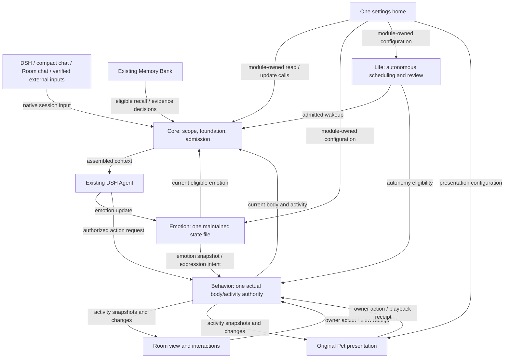
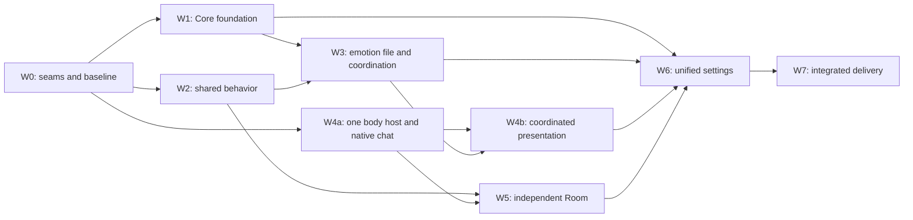

# Four-feedback modification plan

Revision: draft 1.0, 2026-11-12, Asia/Ho_Chi_Minh.

Status: detailed proposal for owner review. The four product requirements are
confirmed in [the product plan](mvp-1.0.md#owner-trial-redesign-feedback).
Component additions, interface names, file formats, migration policies and the
delivery sequence below are recommendations, not separately accepted decisions.
This document does not authorize implementation, installation or paid model use.

## 1. Result the owner should receive

One bound companion, one normal desktop body and one coherent settings entry.
The owner can open Room in its own window without visiting settings. Room and
Desktop show the same actual activity. Emotion persists independently of either
surface and influences both the companion's choices and its expression. Pausing
autonomous Life still permits owner-directed interaction and care.

An eligible ordinary conversation keeps the companion's identity, basic rules
and permitted self-description even when Life is not loaded. Memory keeps its
existing Bank, capture, recall, correction, forgetting and new-session admission
semantics. DSH remains the sole assistant runtime and native conversation writer.

### Requirement-to-delivery map

| Requirement | Observable result | Main packages |
| --- | --- | --- |
| F1: Core foundation without Life | Text chat receives the foundation and can maintain eligible self-description without Life; optional capabilities are described only when available. | W1, W3, W7 |
| F2: Emotion and shared behavior | Sleep, eating and emotional expression agree across Room/Desktop; reopening reads current state; manual care works with Life paused. | W2, W3, W4, W5, W7 |
| F3: Unified, World-based settings | One settings home, no accidental extra body, one editor per setting, clear saved/effective states and a visually reviewed World-derived layout. | W4, W6, W7 |
| F4: Independent Room window | A daily-use entry opens or focuses Room without mounting settings; closing the view does not erase the companion's state. | W5, W7 |

### Explicitly retained scope

- Keep persona, USER, self-description, memories, complete native conversations,
  existing body/garden progress, photos, diaries, custom packs and configuration.
- Keep native Chinese chat, streaming, stop, reopen, attachments and session IDs.
- Keep intentional multiple bodies, browser/desktop presentation, supported
  upstream interactions, speech adapters and external-account isolation.
- Keep Memory-off behavior: recorded old conversation modes stay unchanged;
  new admission follows the current switch. No Memory algorithm redesign.
- Preserve origins, licenses and the repo-local toolchain. Do not replace global
  runtimes or the installed DSH application.
- Do not merge conversation histories or select one universal chat session as a
  side effect. That product choice is still open.
- Do not introduce another agent, emotion-model service, vector memory system,
  general psychological simulation or per-frame inference loop.

## 2. Evidence and the current gaps

Source baseline inspected in this discussion: `main` at
`676bd65f61a0086249575d4077cd0587950b8b36`. The working tree already contains the
owner's feedback edits in `mvp-1.0.md` and `../handover/README.md`; preserve them.
The installed trial build is recorded as `6e5c1796d459`. Earlier in this chat,
989 installed archive files matched the release archive. That dated comparison
does not establish future installation state or subjective acceptance.

This planning pass reads source only. It has not run tests, launched windows,
called a model, changed personal data or reinstalled anything. The owner's UI
reports are owner observations, not screenshots captured by this planning pass.

| Observed seam | Evidence | Consequence |
| --- | --- | --- |
| Core supplies SOUL/USER and Memory policy; self-description setup lives with Life. | `src/core/agent.ts`, `src/life/review.ts`, `src/life/review-writing.ts` | Moving a prompt paragraph alone will not make ordinary self-description updates independent of Life. Scope and evidence guards must move with the reader/writer integration. |
| Verified owner external messages resolve their home only while Life runs. | `src/channels/plugin.ts:42-48`, `src/channels/sessions.ts:45` | Separate foreground native-home resolution from autonomous Life admission; otherwise this input fails while Life is paused or absent. |
| Emotion directly loads Desktop assets and stores current emotion in Core records. | `src/emotion/plugin.ts:11-85` | State ownership and display capability discovery are coupled. Text-only Emotion must survive absent displays/assets. |
| Emotion and the platform can lose their connection after Emotion reload. | `src/desktop/platform/plugin.ts:149-161`, `src/emotion/plugin.ts:193-199` | Replace captured-instance subscriptions with lifecycle-safe service/event use. |
| Emotion retirement relies on live correction/forget tool events. | `src/emotion/plugin.ts:154-166` | Reload/read must revalidate retained dependencies; live event delivery alone is insufficient. |
| Life owns the body, garden caretaker, serialization and timer. | `src/life/plugin.ts`, `src/life/room.ts` | Disabling that owner removes manual behavior progression along with autonomy. |
| Upstream body advancement mixes existing-task progress and autonomous choices. | `vendor/feiyu-room-template/home-state.js:1112-1278` | Removing a Life-enabled check alone would unintentionally restart autonomy. |
| Garden already distinguishes requested and automatic jobs. | `vendor/feiyu-room-template/src/garden-autonomy.js:256-275` | Reuse this distinction and its effects/receipt commit semantics. |
| Two settings and two body-host paths are composed into the product. | `src/console/settings.ts:231-240`, `src/desktop/index.ts:150-159`, `src/desktop/platform/plugin.ts:162-184`, `scripts/build-pet-platform.mjs` | Hiding a settings label will not remove the second independently controlled body. |
| The platform's compatibility chat waits for a final answer. | `src/desktop/platform/plugin.ts:220-249` | Replacing compact chat with that endpoint would regress streaming and stop. Reuse the native controller and snapshot path instead. |
| Room relies on a parent-frame bridge owned by settings. | `src/console/client.js:188-209`, `vendor/feiyu-room-template/public/room/native-room.js:9-24` | Opening the static Room URL directly in a new window is insufficient. |
| Some historical contracts name Desktop as the sole body/world writer. | `src/contracts/desktop.ts:28` | Update affected current contracts; do not leave conflicting ownership declarations in place. |

## 3. Recommended route and reuse boundaries

### Routes considered

| Route | Benefit | Material limitation | Recommendation |
| --- | --- | --- | --- |
| Retain both body hosts and synchronize them indirectly | Small initial visual patch | Retains duplicate lifecycle/configuration authorities and makes open/close/status ambiguous. | Reject for the final design. |
| Replace the companion with the complete original World plugin | Complete original World workflow | Does not preserve the selected native-session/compact-chat contracts without additional adaptation; risks another history/persona authority. | Do not adopt wholesale. |
| Reuse original Pet presentation and feiyu behavior, separate ownership, keep the existing native bridge | Retains proven motion/assets, original body/garden logic and native chat/Memory | Needs bounded lifecycle, autonomy-gating and Room-carrier integration. | Recommended. |

World 0.7.4 is the source for editable/scoped prompt sections, self rendering and
the settings structure. feiyu-room-template remains the body/garden state machine.
dsh-pet 0.4.7 remains the body renderer, motion, input, multi-body and window
implementation. The existing Conversation and Features adapters remain the route
to DSH streaming, attachments and already selected companion functions.

### Concrete adaptation gaps to agree before custom control changes

1. Expose a narrow autonomy gate in the reused body/caretaker path: progressing
   an admitted manual task must be possible without selecting new autonomous
   goals. Preserve default upstream behavior when the gate is not used.
2. Bridge shared behavior phases into original Pet scheduling so a cosmetic
   random/work animation cannot contradict an actual sleeping/eating state.
3. Separate Room's existing owner/RPC carrier from its settings iframe, then
   attach it to a normal independent window.
4. Reuse upstream settings editors as embedded components while registering
   only one companion settings home.

These are proposed adaptations to evidenced gaps, not permission to replace
the upstream engines. W0 verifies the existing paths before dependent changes.
If an existing host/upstream mechanism already meets a seam, use it unchanged.

## 4. Proposed responsibility and runtime arrangement

Figure 1 is a proposed logical view. Arrows label calls/context/observations;
boxes are responsibilities, not separate assistant processes.

| Responsibility | Proposed owner and boundary |
| --- | --- |
| Native sessions, input scope and deterministic execution/permission controls | Existing Core/DSH. Core assembles context; it does not choose physical activity independently of the native Agent/body state machine. |
| Foundation document and identity resources | Core. SOUL/USER retain their roles; self-description has a guarded Core identity-resource reader/writer integration independent of Life. |
| Facts, evidence eligibility and long-term recall | Existing Memory service. Consumers use public adapters to its current decisions; no independent withdrawal ledger. |
| Continuing emotion and expression intent | Emotion. No dependency on Room/Desktop being installed. Presentation capability descriptions are supplied through interfaces, not loaded from another module's private files. |
| Actual body, active activity and effect settlement | Proposed optional native `25-Behavior` / `petBehavior`, extracted from existing Life-owned `CompanionRoom` and caretaker. No model or chat runtime. |
| Autonomous wakeups, next autonomous opportunities and daily review | Life, using original World factories. Pausing autonomy does not unload Behavior. |
| Room scene, scene interactions, photography and Room window | Room, consuming Behavior. Remove its hard dependency on `petLife`; do not make its independent window depend on Desktop being enabled. |
| Desktop body rendering and body configuration | Original PetPlatform, as the sole normal body host. Existing Desktop code retains the native Conversation/Features facade. |
| Diaries and album storage/tools | Keep the existing owning capabilities and file/store formats. Do not create a new Records module merely for this plan. Core conditionally describes capabilities actually registered; Life-paused passive reads/tools must not be gated by autonomous running state. |
| Unified settings | Console, delegating writes to owners. No direct Bank, emotion-file or body-file writes from the UI. |

`25-Behavior` is the principal proposed component addition. This location avoids
making basic body actions depend on Life, Emotion or a particular display. An
existing native service with the same independent lifetime can be used instead
if W0 establishes that it already satisfies these boundaries.

The facade/platform dependency must remain acyclic: Desktop provides native chat
and Features without requiring PetPlatform; PetPlatform consumes those services.
Facade open/close/status can discover the presentation service at use time. Do
not make both plugins require the other's service before either can start.

## 5. Product behavior and proposed contracts

### 5.1 Foundation document and ordinary self-description

Recommended new portable document: `.chatpet/COMPANION.md`. The name is proposed.
It holds editable basic guidance and conditional capability sections. It does
not duplicate SOUL, USER, the Memory Bank or large histories inline.

Treat this as an optional portable resource in the first revision. Keep the
current manifest schema and exact required-file lists compatible. If the file
is missing, use the shipped scoped default without modifying the Repo. Only
explicit initialization/editing creates the owner copy; existing content is
never replaced by a newer template. Verify setup, resume, backup and portability
preserve the optional file. A missing optional document must not invalidate an
existing binding or require an older installer to understand a new manifest.

Assembly order: owner persona/USER and foundational rules, eligible self,
current module state and available capability guidance, selected Memory context,
then the native conversation's existing active context. Exact placement reuses
`registerWorldPrompt` and native prompt section ordering rather than concatenating
a second transcript. Stable sections refresh only when their inputs change.

Foreground native-session resolution must not depend on Life running. For
verified owner private inputs, reuse the recorded home session through native
session/persistence services while preserving its ID and transcript. If no home
exists, reuse the original native-home creation mechanism without starting
autonomous scheduling. Replace the running-only owner-home checks with a trusted
session/binding check. Paused/absent Life still cannot admit autonomous Life
messages. External guest/group routing and permission isolation stay unchanged;
this does not merge the owner's different chat histories.

The foundation contains the eight confirmed F1 groups. Life-only schedules,
autonomous event wording and proactive-contact timing remain separate sections.
A World-style global Stop must not remove Core identity or Memory from ordinary
eligible conversations. UI controls must distinguish autonomous pause, hiding a
body and disabling a component.

Self-description keeps its existing content and provenance. For the first
migration, retain the existing `.chatpet/data/life/self.md` location while
reassigning the guarded identity-resource integration to Core. A legacy directory
name is not an ownership contract. Avoid moving files just to improve naming.
New path cleanup can be considered separately after continuity is established.

Reuse World's six-section self rules and bounded renderer. Reuse the current
writing guard's source dependencies/private-mode treatment. Ordinary eligible
conversation updates and scheduled Life review use the same resource path.
Never expose a self-description derived from a private or withdrawn source merely
because Life is absent. Memory facts do not automatically rewrite SOUL or USER.

### 5.2 Emotion file and capability-driven expression

Recommended canonical file: `.chatpet/data/emotion/state.json`. Emotion is the
runtime writer; the same native Agent requests changes through its interface.
Owner editing remains possible through a validated editor. Unknown/corrupt or
concurrently changed content is retained and reported rather than overwritten.

| Proposed field group | Meaning and compatibility requirement |
| --- | --- |
| Schema/revision/scope | Explicit schema, companion/storage identity and revision/content hash for optimistic concurrency; validate against the bound companion. |
| Current feeling | Human-readable mood, reason and update time; retain existing text-only states. |
| Optional numeric representation | Preserve existing Room `roomMood` values/dimensions unchanged. No automatic conversion from original World's 0-10 scores. |
| Sources | Existing memory/source dependencies that support a reason or derived state; validate through the owning services. |
| Change information | Enough to identify the current change and support the existing recent-mood view, without an unbounded prompt history. |

Do not select a new decay equation, reward system or fixed psychological model
as an implementation detail. Recommended first delivery uses the existing text
plus compatible optional Room values. Anger and boredom must be represented
explicitly in the agreed emotion/expression contract; neither may be silently
reduced to happiness or inferred by exact keyword branching. W3 maps available
actions and Room support before freezing numeric dimensions.

Replace the current requirement that every mood update provide a Room-specific
payload. Text-only chat must update emotion without a display. Registered display
capabilities can advertise action meanings and supported expression dimensions;
the native Agent selects from those capabilities in the same turn.

Retain source invalidation: revalidate on reload and before publishing state to
the model or a surface. A live correction event is an optimization, not the only
way to retire an invalid reason. On unknown/ineligible dependencies, withhold the
affected derived content and show a repairable unavailable state; do not relabel
old content as independently valid or silently use the old Core row.

### 5.3 Shared behavior service

Keep the original `home.json`, `garden.json`, route/dwell state and garden receipts.
Initially retain `.chatpet/data/life/` paths. Transfer their single runtime writer
to Behavior; Life/Room/Desktop stop constructing their own body state/timers.

| Interface operation, proposed name | Required semantics |
| --- | --- |
| `snapshot(scope)` | Current binding/storage identity, revision, body state and active action/phase. Read-only. |
| `request(scope, command, requestId, expectedRevision)` | Admit an explicit owner/native/Life action through trusted caller context; reuse idempotency and original validation. Origin text alone grants no authority. |
| `inspect(actionId)` / `cancel(actionId)` | Return actual accepted/running/terminal result, or stop at a valid checkpoint. Do not count cancellation as completion. |
| `setAutonomy(enabled)` | Change eligibility for new autonomous choices and the agreed handling of active automatic tasks. Does not unload manual execution. |
| Native state-change event | Advisory revision/action invalidation; consumers query a fresh snapshot. Ignore old revisions and recover after missed events. |
| `reportPresentation(surfaceId, actionId, revision, status)` | Record actual start/end/failure of a presentation. Cannot commit body effects or assert that eating is complete. |

Only the owning service advances body/garden time and commits effects. Reuse the
upstream atomic completion/receipt path; render callbacks must not apply hunger,
crop, inventory or money changes. Repeated user requests, refreshes or stale
animation completions cannot settle an action twice.

Use existing activity semantics where available: pending/requested, moving,
arrived/working, completed/cancelled/failed. Preserve the distinction between
walking to bed and actually asleep. Scene coordinates and desktop screen
coordinates remain surface-specific; shared semantic activity and phase agree.

### 5.4 Paused autonomy: recommended policy requiring confirmation

- No new autonomous model wakeups, spontaneous body goals or automatic garden
  jobs while Life is paused.
- Owner-requested care, movement, sleep/wake and garden work remain available.
  Their accepted route/dwell work can progress to an actual result without Life.
- Stop an already active automatic job at the next safe durable checkpoint;
  do not manufacture completion. Explicit owner work takes precedence.
- For the first change, preserve the current paused-time baseline for passive
  needs/crop progression rather than silently adding offline catch-up. Advance
  explicit tasks using a separated task clock without replaying autonomous goals.
  The exact passive-time rule must be confirmed in W0 before this seam is coded.
- Resuming Life retains the current body and queued explicit work. It must not
  replay every missed alarm or replace a manual action with a new autonomous one.

The first two bullets implement the confirmed direction. Active automatic-task
cancellation and passive-time behavior are proposed details, not settled owner
preferences. If the original state machine cannot provide this separation via a
narrow seam, return the concrete limitation before selecting a replacement.

### 5.5 Expression and activity arbitration

| Situation | Recommended observable behavior |
| --- | --- |
| Angry while eating | Keep actual eating; apply supported angry expression/wording without switching only one surface to another activity. |
| Happy while asleep | Remain asleep. A new emotion does not wake her without an admitted wake decision. |
| Bored while idle | The native Agent may choose a different permitted activity on conversation/autonomous opportunity. No model call per render frame. |
| Dragging a body | Temporary local input/motion priority; it does not independently change the room's eating/sleep facts. |
| Work-status animation during another activity | Work is an execution indicator, not the companion's emotional/physical state. Use a noncontradictory indicator or defer the conflicting clip. |
| Cosmetic random action implies eating/sleep | Schedule it only against the corresponding actual activity, or reclassify it as unsupported for that state. Audit upstream pools rather than allowing false cross-surface facts. |
| Requested activity has no surface asset | Expose a presentation gap; preserve truthful shared state. Fill the required asset/mapping before claiming that activity's visual acceptance. |

Eating and sleep assets already exist in the packaged catalogue, including
`吃早餐`, `吃午餐`, `吃晚餐`, `吃饭·碗饭` and the three sleep clips.
Their existence is not proof of a correct phase/mood mapping or playback result.
Inventory exact files, meanings and behavior compatibility in W3/W4. Do not
generate new media until a concrete missing representation is established.

## 6. One body host and one settings home

### 6.1 Selected host route

Use original PetPlatform as the single normal body host. Keep Desktop's native
Conversation/Features service; retire its independent blue-fish body creation.
All ordinary open/close/status commands, startup restore and connected standalone
entry must address the same companion/body registry.

Reuse the existing compact UI and native controller. Prefer hosting its window
under the selected presentation host. If that requires a chat-only carrier,
it must not construct the old body or own another Agent/history. Do not use the
platform's final-answer-only compatibility chat as a substitute for streaming.

Connected standalone attaches to the managed body/session, without duplicating
it. Preserve explicit offline standalone use, visibly separate from a connected
companion and without presenting it as synchronized live state.

Keep intentional multi-body support: independent appearance/position, one shared
companion emotion/behavior. Initializing a platform `main` entry is not evidence
that the owner requested another body. Viewing settings never creates a new body.

### 6.2 Configuration ownership and reconciliation

Body appearance, surface selection, per-body position and packs become
PetPlatform-owned. Core keeps identity and execution settings, Memory its own
parameters, Emotion its own state/options, and Life its schedules. The settings
carrier delegates and does not maintain browser-local competing configuration.

Before migration compare legacy Core desktop fields with original platform
configuration. Import into fields that are absent or demonstrably unmodified
initial defaults. Preserve explicit platform values. Where both sides were
modified incompatibly, show a field-level choice; never resolve by file time or
by creating two bodies. Preserve unknown values/custom packs for review.

After migration stop dual writes; retain an idempotent receipt and read-only
backup. Use the existing action catalogue to map legacy IDs to upstream labels.
Do not let original per-body persona/model options create independent companion
identities or assistant runtimes.

### 6.3 Proposed settings arrangement

Reference: original World 0.7.4 `client/index.js`, especially `View`, `Card`,
`PersonaEditor`, `PromptEditor` and its compact field/save layout. Reuse its
presentation patterns, not its global power behavior or archive implementation.

| Proposed page | Everyday content |
| --- | --- |
| Overview | Identity/status, current activity, show/hide body, open Room, clear faults. |
| Role and instructions | SOUL, USER, foundation, permitted self-description and effective prompt preview. |
| Emotion and behavior | Current feeling/reason, actual activity, existing selected controls and clear unavailable states. |
| Memory and archive | Existing recall/batch controls, scoped search and source detail. |
| Desktop appearance | Selected body, body list, appearance, packs, position/surface and interaction settings, using upstream editors. |
| Room and Life configuration | Room options, autonomous switch, schedule/budget and diary/album access; no embedded full interactive Room. |
| Connections | QQ, WeChat, bridge and speech, with clearly distinct account/status/control groups. |
| Advanced | Repo binding, execution limits, module health, migration/conflict records. |

Final tab names/count and visual details remain proposed. At the start of W6,
inspect the actual World reference screen and the actual current screens, then
show one coherent layout for owner review before implementing the full settings
change. Do not turn this into an unrelated design-system or image-generation
project. Capture actual before/after screens for visual acceptance.

Use one identity/status header, clear topic navigation, focused cards, consistent
spacing and field alignment, and a visible save/result area. Separate saved,
unsaved, currently effective and restart-required states. Preserve form drafts on
errors and stale revisions. Respect keyboard focus, labels, narrow windows,
dark/light appearance and reduced-motion preferences.

## 7. Independent Room window

Preferred daily entry proposal: desktop context menu `进入房间` plus an entry
available without a visible desktop body, such as a DSH command/button. Global
shortcut is optional and off until an exact key and scope are chosen. The owner
did not require all three input mechanisms.

Window contract: open creates the first view; open again restores/focuses it.
Closing Room releases rendering/capture subscriptions without resetting Behavior,
stopping Life, clearing history or deleting data. Reopen reads the current shared
state. Do not replay old action starts as new commands.

First inspect and exercise any existing DSH independent-window/owner-auth service.
This planning pass has not confirmed such an API. If absent, reuse installed
Electron and existing secure preload/window-carrier patterns for a Room-only
window. It is a renderer carrier, not another pet host or assistant runtime.
Room must remain accessible with Desktop unloaded, so its lifetime cannot be
owned solely by a desktop-pet helper process.

Extract the existing parent-frame MessageChannel/RPC bridge into a carrier that
works outside settings. Static scene assets remain public packaged resources;
personal state and commands still use trusted owner Connection/capabilities.
Opening `/chatpet-room/index.html` alone is not the implementation.

| Window concern | Required treatment |
| --- | --- |
| Authentication | Bind owner, workspace and view lifetime; least Room-specific operations, no general proxy or filesystem bridge. |
| Preload/frame | Isolated context, no renderer Node access, exact sender/frame validation and restricted navigation. |
| Credentials | Do not place owner tokens in URLs, logs or portable Repo configuration. Revoke temporary view capability on close/rebind/unload. |
| Rebinding | Old view immediately loses old workspace access; close or explicitly refresh before showing the new binding. |
| Geometry | Normal resizable window, recoverable on screen after display changes; no automatic pet-style transparency/click-through/forced always-on-top. |
| Capture | Keep existing TV/screenshot/photo permission flows; closing the view releases active capture. |
| Shutdown/crash | Clean subscriptions and temporary capabilities, preserve persisted business state and permit reopening. |

Keep Room's existing native conversation mapping and complete history for this
release. Moving the window does not decide whether it should share compact-chat
history. That remains a separate product decision.

## 8. Implementation work packages

Every package owns one reviewable result, its source changes, proportional
verification and a stop point. No package may declare the whole release accepted.
Execution is not started by this plan. Proposed checks below are future work.

### W0 — Settle seams and preserve the baseline

**Deliverable:** an implementation-ready boundary decision and retained recovery
inputs, without modifying the personal installed package.

- Confirm the proposed Behavior owner, pause/passive-time rule and single Pet
  host route. Freeze only affected contracts, not the entire historical catalogue.
- After implementation authorization, exercise original body/caretaker autonomy
  separation and native window/compact carrier mechanisms on disposable data.
  Use no paid model and no personal account. Explain a concrete unsupported seam
  before introducing custom control logic.
- Retain current source changes and original archive/receipts. At migration time,
  take consistent offline backups of affected files/databases; never copy an
  actively written SQLite database without its supported snapshot/checkpoint.
- Inventory both desktop configurations, source eligibility metadata, body/garden
  progress and current session references. Inspect values only as needed; do not
  reset them to defaults.

**Acceptance/stop:** responsible owner and each producer/consumer interface are
clear; narrow upstream gaps are identified. Stop dependent control changes if
the pause rule or single-writer transition is unresolved. No exhaustive new
reference survey or replacement framework.

### W1 — Deliver the Life-independent Core foundation

**Inputs:** F1 and W0 scope/identity/evidence boundary. Can proceed independently
of presentation work once the shared context contracts are agreed.

**Changes:**

- Add the editable foundation resource, native scoped assembly and effective
  preview; preserve existing SOUL/USER and custom instructions. Keep it optional
  with a shipped fallback so old manifests and Repo bindings remain valid.
- Extract self reading/writing integration from Life lifecycle into Core's
  guarded identity resources; retain original file path and eligibility lineage.
- Keep optional capability sections conditional. No prompt may claim unavailable
  diary, album, emotion or behavior tools are active.
- Keep stable-prefix change detection, de-duplication and removal when leaving
  the bound workspace. Do not append a full new foundation on every message.
- Decouple verified-owner foreground home/session resolution from Life's running
  flag. Preserve the recorded home ID and owner/account checks; Life-off continues
  to deny autonomous wakeups while allowing a verified foreground conversation.

**Primary files:** `src/core/agent.ts`, `world-prompt.ts`, `workspace.ts`, proposed
`src/core/companion-foundation.ts` / `companion-writing.ts`,
`src/life/review.ts`, `review-writing.ts`, `src/channels/{plugin,sessions}.ts`,
`src/console/settings.ts` and scoped contract declarations. Inspect
`scripts/setup-runtime.py`, `scripts/lib/portable-repo.mjs` and the portability
check for optional-resource compatibility. Existing World template/self and
native-home mechanisms remain reuse inputs.

**Acceptance:** Life completely unloaded; an eligible ordinary native conversation
gets the saved foundation/self, edits refresh on the next applicable request,
and a valid self update is visible later. Another workspace/guest/private-source
case does not leak content. Missing optional modules do not cause false tool
claims. Stable follow-ups do not gain duplicate foundation copies. Verified owner
private input continues through the existing home with Life paused/unloaded;
guest input cannot gain owner access. A legacy Repo with no foundation file still
binds, while an owner-created optional foundation survives copy/resume.

**Stop:** one complete text-only path, including guarded update and later read.
Do not redesign Memory extraction or unrelated Core workbench functions.

### W2 — Deliver shared actual behavior with manual care while paused

**Inputs:** W0 owner/pause decision and bounded feiyu seam. W1's UI is not required.

**Changes:**

- Extract `CompanionRoom`, caretaker lifetime and serialization into Behavior.
  Keep original home/garden formats, receipt semantics and algorithms.
- Add the independent native entry and minimal current contracts. Convert Life,
  Room and Desktop sleep/wake/action calls into clients of the same service.
- Introduce only the agreed autonomy gate; explicit requested tasks can advance
  without opening new autonomous goals. No tick may call another assistant.
- Publish committed state revisions/action phases. Reopening consumers query
  fresh snapshots; presentation acknowledgements do not settle body effects.
- Remove `standaloneSleep` as a competing authoritative state when Behavior owns
  the companion. With Behavior absent, basic display/chat remains available but
  must not claim live shared physical state.

**Primary files:** `src/life/room.ts`, `src/life/plugin.ts`, proposed
`src/behavior/{plugin,service}.ts`, `src/contracts/behavior.ts`,
`src/contracts/desktop.ts`, `src/room/plugin.ts`, `src/desktop/features.ts`,
`package.json`, `cordis.patch.yml`; narrow upstream seam and provenance records
only if original code requires adaptation.

**Acceptance:** with Life paused/unloaded, manual feed, sleep/wake and a requested
garden task progress and settle once. Walking to bed is not already asleep.
Repeated requests, cancellation, restart and rebind retain correct receipts.
Room need not be open for an admitted task to finish. No automatic new goal or
model wake occurs under the agreed paused policy.

**Stop:** independent Behavior plus working existing Room/API consumers. Do not
add new psychological or garden-planning algorithms.

### W3 — Deliver the maintained emotion file and behavior/expression seam

**Inputs:** W1 context/evidence seam; W2 actual-activity contract for coordination.

**Changes:**

- Import existing emotion once into the canonical file, preserving text, optional
  Room representation and source references. Stop current-state Core-row writes.
- Add validated revisioned update/read, reload/read-time eligibility and visible
  malformed/conflict states. Keep recent actual playback records distinct.
- Discover supported expression capabilities through services. Remove direct
  ownership of Desktop asset-file loading and mandatory Room payloads.
- Maintain the same native Agent/turn path. An emotional change affects both
  proposed activity and permitted expressions, without canceling actual work in
  only one surface.
- Complete an explicit state/phase-to-asset compatibility table for sleep,
  eating, happy, angry and bored examples. Unsupported combinations remain a
  delivery gap requiring a specific adaptation/asset decision.

**Primary files:** `src/emotion/{plugin,index,recent}.ts`, proposed
`src/emotion/state.ts`, `src/contracts/emotion.ts`,
`src/core/native-memory.ts` public eligibility adapter only,
`src/desktop/platform/plugin.ts`, Behavior's snapshot/capability boundary.

**Acceptance:** Emotion operates in text-only chat; old text-only entries do not
gain invented scores; file edit/reload is visible; conflicting writes preserve
the original. Correction/forget during Emotion unload is respected on reload.
Room and Desktop use one eligible state; neither keeps a private emotion engine.

**Stop:** the agreed file and supported example behaviors, not a new emotion
simulation. Numeric dimensions/decay not approved in W0 remain unimplemented.

### W4 — Deliver a single desktop body host without losing native chat

**Inputs:** W0 PetPlatform selection; W2/W3 contracts can be implemented behind
adapters while this package proceeds. W4a is a separately reviewable single-host
and native-chat checkpoint. W4b completes cross-state integration after W2/W3.

**Changes:**

- Keep original Pet body management; disable the old facade's body construction.
  Implement common body open/close/status and explicit multi-body management.
- Keep native Conversation, Features and compact UI; connect stream snapshots,
  stop, attachments and reopen to the chosen host/carrier.
- Separate loading settings/status from spawning a body. Connected standalone,
  startup restore and old entry aliases resolve the existing managed body.
- Apply the configuration reconciliation in section 6.2; stop legacy dual writes.
- Use native lifecycle-safe subscriptions so Emotion/Behavior reload reconnects.

**Primary files:** `src/desktop/{index,plugin,conversation,features,appearance}.ts`,
`src/desktop/platform/{plugin.ts,browser-entry.js}`, `src/desktop/helper/chat.*`,
`preload.cjs`, `main.cjs` body/carrier split, `src/desktop/standalone.mjs`,
`src/console/settings.ts`, `src/core/companion-settings.ts`,
`scripts/build-pet-platform.mjs`, affected package exports/provenance.
Do not hand-edit generated `src/desktop/platform/client.js`.

**Acceptance:** normal entry, both old routes, settings browsing, save, restart and
connected standalone do not add a second default body. Explicitly adding a body
does. Chinese stream/stop/reopen/image/new/archive/session continuity all remain.
The status and close controls refer to the actual visible host. These establish
W4a. W4b additionally requires sleep/eating and expressions to agree with current
state after component reload, using completed W2/W3 contracts. W4 is not fully
complete at the W4a checkpoint.

**Stop:** one body manager with retained selected features. Do not rewrite motion,
drag, collision or animation decoding merely to unify lifecycle.

### W5 — Deliver the independent Room window and daily access

**Inputs:** W2 Behavior; W4a for desktop-menu integration. An independent DSH entry
must still work when Desktop is absent.

**Changes:**

- Select the verified native host window service, or the documented Room-only
  Electron carrier fallback. Extract the current settings-owned bridge.
- Implement open/focus/close/status, owner/workspace-bound operations and cleanup.
- Add the agreed context-menu/DSH command or button. Leave an unspecified global
  hotkey unregistered; avoid choosing a conflicting system-wide shortcut.
- Remove the interactive Room iframe from ordinary settings use; retain Room
  configuration and, optionally, an auxiliary open button.
- Keep the original 3D scene, garden, photography, TV and native Room chat route.

**Primary files:** `src/room/{plugin,assets,chat,photo}.ts`, proposed Room carrier /
preload files only if needed, `src/console/client.js`, Room settings routes,
`src/desktop/platform/plugin.ts` menu integration, native-room bridge adapter and
provenance if changed. Existing scene/model/media files remain unchanged.

**Acceptance:** open without settings; repeat opens focus the existing window;
close/reopen restores current activity; no second pet or Agent is created.
Room works with Desktop disabled. Life-paused manual care works. Rebind/unload
revokes old view access. TV/photo flows retain their permission and capture limits.

**Stop:** independent, authenticated, useful Room access. No new shared chat history
policy, Dock customization, global shortcut framework or room-engine rewrite.

### W6 — Deliver the unified World-based settings

**Inputs:** W1-W5 owner/configuration contracts. The one-page visual reference
review can start earlier; final data/control wiring follows the owner services.

**Changes:**

- Inspect actual World/current settings screens and prepare one proposed layout
  for visual review. Use original World's header/navigation/card/field patterns.
- Register only `大肥鱼`; embed the original Pet appearance editor rather than
  retaining a second `桌宠配置` settings registration.
- Apply the proposed topic grouping after visual review. Remove duplicated fields
  and full-room embedding; place diagnostics behind the advanced area.
- Preserve revision checks, drafts, module-unavailable states and precise save
  feedback. Distinguish Life pause, body visibility and component lifecycle.

**Primary files:** `src/console/{client.js,settings.ts,plugin.ts}`,
`scripts/build-pet-platform.mjs`, `src/desktop/platform/browser-entry.js`, upstream
settings editor extraction/adaptation and associated documentation/provenance.

**Acceptance:** one visible settings home; every setting has one effective editor
and a named owner; normal usage never spawns another body. Actual narrow/wide,
light/dark, keyboard and save/error/rebind screens are inspected. The owner
evaluates arrangement and appearance against the World reference. Source checks
alone cannot mark the visual requirement accepted.

**Stop:** usable daily settings plus advanced maintenance access. Do not expand
into a general-purpose settings framework.

### W7 — Integrated migration, package and owner trial

**Inputs:** accepted package-level evidence from W1-W6 and a reviewed migration.

- Run required changed-surface checks with the repo-local toolchain. Reuse the
  native fixture checks and original renderer/state-machine cases; add only
  meaningful missing cross-module cases. Keep fixture inference local.
- Run one end-to-end disposable-profile journey spanning all four feedbacks,
  including unload/reload, restart and migration replay.
- Build the final archive after the final source change; compare installed files
  against that archive only when installation is requested. Preserve old package,
  personal profile/configuration and data backups.
- Conduct the owner trial with the actual fish, Room and settings. Record each
  outcome as source-reviewed, fixture-verified, installed-observed or owner-accepted.
- Real-provider language/autonomy quality, personal channels and physical device
  behavior are separate checks. No old cost allowance is renewed by this plan.

**Stop:** all four feedbacks have observable acceptance evidence, migration is
replayable/recoverable and remaining limitations are explicitly identified. Do
not claim completion from a test count or one successful greeting.

### Dependency and usable-increment order

W1, W2 and the body-host portion of W4 have separable outputs after W0. Parallel
work is appropriate only with frozen interfaces and disjoint file ownership.
Changes to `package.json`, bundle composition, shared contracts and final data
migration must be integrated serially by the coordinating implementer.

First usable increment: W1 provides the text-only foundation. The first combined
desktop checkpoint is W2 + W4a + W5: one body, manual care while paused and direct
Room access. This does not claim W4 complete. W3 + W4b complete emotional
behavior/expression coordination; W6 completes the normal settings experience.
Internal checkpoints are not the complete requested release.

Effort confidence: W1 medium; W2/W3 high; W4 high; W5 medium/high; W6 medium;
W7 depends on migration/window findings. Do not promise an exact completion time
from source review. After W0, estimate each bounded package from its verified
reuse seam and report any change before widening it.

## 9. Data transition and rollback contract

| Data | Proposed treatment | Recovery requirement |
| --- | --- | --- |
| SOUL, USER, binding and native identity | Preserve contents/IDs. Foundation is optional: a missing file uses a shipped fallback; create an owner copy only through explicit initialization/editing. | Preserve existing manifest required-file compatibility; no upstream sample persona or default overwrite. |
| Existing self/diary/album | Retain bytes and paths; move lifecycle responsibility/guards, not data by default. | Preserve privacy/evidence linkage; missing eligibility is not consent to publish. |
| Current Core emotion row | One-time validated import to Emotion file; preserve optional Room values and source references. | Retain old row for rollback only; never live dual-read/dual-write. Conflicting new content stops automatic migration. |
| Home/garden/active work | Reassign writer to Behavior with original formats and receipts. | Quiesce the previous writer first; do not run two tickers; retain accepted/manual versus automatic task distinctions. |
| Two desktop configuration sources | Reconcile field by field into upstream body configuration. | Keep both original files and unknown fields/packs. Do not resolve conflict by adding another body. |
| Memory Bank and native logs | No format change or re-extraction planned. | Preserve source IDs, versions, session IDs and complete event prefixes. |
| Window geometry and credentials | Device-local state/capabilities. | Do not add device paths/tokens to portable persona or committed personal records. |

Migration should support inspect/prepare/apply/readback stages and a durable
versioned receipt using existing file-write/migration facilities where possible.
On failed validation keep original data and report the precise conflict. Repeat
migration must not duplicate bodies, summaries, actions or foundation sections.

Before an installed replacement, stop or settle affected work and make a
consistent snapshot. Reverting the package alone is insufficient if an older
package could resume writing stale emotion/body/configuration. Rollback must
restore the matching affected data snapshot, or use an explicitly verified
compatibility path. Retain any new records for recovery; never erase them merely
to make rollback appear clean.

## 10. Verification and owner acceptance

The following is a future verification plan, not a list of completed checks.

| Case | Required result | Evidence level |
| --- | --- | --- |
| Life absent, ordinary owner chat | Foundation and permitted self remain; unavailable tools omitted; later read sees a valid self update. | Scoped native fixture, then owner conversation. |
| Input/Life matrix | DSH, compact, Room and verified-owner private inputs retain their intended native routes with Life on/paused/unloaded; guest/group inputs stay isolated in every mode. No autonomous Life-source message enters while paused/unloaded. Room cases run after W2/W5. | Scoped native fixtures, then real entry observations. |
| Legacy/optional foundation compatibility | Old Repo with original manifest and no new file binds; owner optional file survives setup/copy/resume and is not overwritten. | Disposable portability and initialization cases. |
| Other workspace, guest, private-derived writing | No persona/Memory/self data crosses its eligibility boundary. | Negative native fixtures. |
| Repeated stable conversation | No repeated full foundation/recall/catalogue accumulation caused by the redesign. | Inspect real formed native requests under a local fixture. |
| Emotion off/on with correction in between | Restored Emotion cannot publish the withdrawn old reason; surfaces reconnect to the new instance. | Lifecycle + real local provider fixture. |
| Paused Life, manual sleep and wake | Pending movement differs from asleep; both surfaces reflect committed phase; no autonomous inference. | Original state semantics + native integration + actual windows. |
| Paused Life, explicit garden work | Accepted work finishes/settles once; no automatic new garden goal. | State/receipt fixture and owner interaction. |
| Angry while eating / happy while sleeping | Feeling changes without contradictory body facts; supported expression matches both surfaces. | Local coordinated fixture and actual visual observation. |
| Scene closed or surface misses events | Reopen reads current action/revision, without replaying effects. | Lifecycle/native + actual windows. |
| Settings, old aliases, connected standalone | Default body count stays one; deliberate additional bodies remain possible. | Host-instance assertions + actual windows. |
| Compact chat | Chinese input, visible streaming, stop, reopen, images, new/archive and session continuation preserved. | Existing native controller checks plus actual compact window. |
| Room direct entry | Independent focusable window opens without settings or Desktop; repeated activation focuses it. | Actual native windows. |
| Rebind/unload with Room open | Old view loses access and capture ends; no stale workspace data displayed. | Owner-route negative check + actual windows. |
| Unified settings save/error/conflict | One editor/owner, correct effective values, drafts retained and no false success. | Service checks + visual interaction. |
| Migration twice, interruption and rollback | Data retained, one writer/host, no duplicated effects; matching rollback data usable. | Disposable copy, then separately authorized installed check. |

Owner trial, proposed order: open the single settings home; hide/show the normal
body; pause Life; open Room directly; request eating and sleep/wake; close/reopen
Room; continue a compact conversation with visible streaming and stop; observe
happy/angry/bored expressions in context; inspect the maintained emotion/self
through their ordinary UI; restart and continue. User experience and natural
behavior quality require owner judgment, not deterministic fixtures alone.

## 11. Decisions, risks and handoff

| Decision/risk | Recommended choice | When it must be resolved |
| --- | --- | --- |
| Independent body owner | Add optional Behavior using existing feiyu code; no new behavior engine. | Before W2 implementation. |
| Paused active automatic work and passive time | Preserve manual progression, stop automatic work at safe checkpoints, retain paused passive-time baseline for this release. | Before autonomy-gating changes in W0/W2. |
| Emotion format and numerical rules | Text plus preserved optional existing Room values; revisioned file and source validation; no new decay engine. | Before W3 schema/migration. |
| Self-description ownership/path | Core identity resource, original guarded path retained initially. | Before W1 read/write changes. |
| Presentation host | Original PetPlatform for bodies; existing native compact capabilities retained. | W0, before retiring any old body entry. |
| Room window host/auth | Verify DSH API first; use Room-only installed Electron carrier if unsupported. | W0/W5 before window implementation. |
| Daily Room entries | Context menu plus DSH command/button; no default global hotkey. | Before W5 entry wiring. |
| Conflicting existing appearance settings | Retain values and request a concrete field-level choice only when conflict is real. | Migration preparation, not a blanket pre-plan questionnaire. |
| Final settings appearance | World-derived layout; owner reviews actual proposed screen. | Early W6, before full UI replacement. |
| Cross-surface shared chat history | Preserve current mappings; decide separately. | Does not block independent Room or shared body state. |

Implementation handoff: the project implementer owns detailed contract finalization,
changes, migration, relevant tests and runtime records. The coordinating role
integrates shared-file changes and prevents multiple writers. The owner evaluates
visual layout, interaction feel and natural behavior. Additional agents may
inspect/review bounded work but cannot supply owner acceptance or approval.

The plan is ready for review of its recommended boundaries and sequence. W0 can
become an execution assignment after an implementation request. No code/package
change, paid run, commit or installation has been performed by this planning task.

### Planning validation performed

Checked document scope, relative links/anchors, patch whitespace and the
requirement/package/dependency mapping. A second-reader planning review found
three omissions/inconsistencies: foreground external-owner input still tied to
Life, W4's first checkpoint versus full integration dependency, and compatibility
of the new foundation with legacy manifests. All three were revised and the
limited follow-up review found them closed. This is document review, not runtime
verification or owner acceptance. Mermaid source connectivity was reviewed; the
diagrams were not separately rendered in this planning pass. Actual World/current
UI captures and native window behavior remain future W6/W5 evidence.
