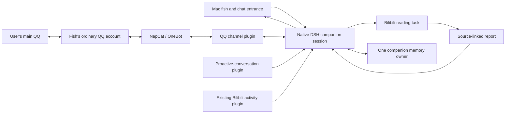

# Project Plan: DeepSeek Harness Dafeiyu

- Project ID: `dsh-dafeiyu`
- Revision: v0.3, overall-design proposal
- Prepared: 2026-11-04, Asia/Ho_Chi_Minh
- Status: Draft for direction review; no installation or runtime acceptance recorded
- Current work: Improve the overall plan; retain the full companion outcome.
- Continuity: This file; exact previous drafts are in [v0.1](snapshots/plan-v0.1.md) and [v0.2](snapshots/plan-v0.2.md).
- Readiness: Sufficient for comparing overall routes. Exact component selection and combined Mac behavior remain unresolved.

## Recommendation And What Changed

Use one native DSH companion session as the center of a local personal assistant.
Desktop chat, ordinary QQ friend chat, autonomous Bilibili exploration, and memory
should all belong to that companion. Reuse existing activity and communication
plugins first. Do not start by building another agent runtime or life scheduler.

The strongest new candidate is a set of existing native-session plugins:
`dsh-fish-memory`, `dsh-qq-link`, `dsh-bili-subagent`, and `dsh-speak-up`, alongside
`dsh-pet` for the blue fish presentation and NapCat for the ordinary QQ account.
This is a preferred candidate set, not a verified compatible bundle. The common
author is useful context, not proof of integration, maintenance, or reliability.

This revises two earlier assumptions. Existing Bilibili plugins already implement
autonomous selection, reading, reporting, and schedules; those responsibilities
must be evaluated before proposing custom activity infrastructure. Native-session
QQ and memory candidates also exist, so the project need not default to an
AstrBot runtime or a new integration built around the old local chatbot.

The largest remaining fit gap is the Mac desktop chat entrance: `dsh-pet` has its
own model-call chat path, and the existing `dsh-fish-buddy` desktop program is
documented primarily as a Windows executable. Neither establishes native DSH
conversation continuity from a Mac floating chat window.

## Confirmed Outcome And Unsettled Choices

The user confirmed:

- A blue fat fish desktop pet serving as a private assistant, with persistent chat
  and a memory system.
- An ongoing life: autonomous activity, including exploring Bilibili, rather than
  only reacting when the user sends a message.
- Its own ordinary QQ account, added as a normal friend of the user's main QQ.
  The user already has a small account available. Official QQ bot identities do
  not meet this selected interaction.
- Local operation while the Mac and DSH are running; shutting down the Mac stops
  activity. No server is required.
- Preference for existing plugins. In response to the Bilibili experience question,
  the user pointed out that an existing plugin is available. This did not select
  literal browser playback or a particular repository; do not record either as
  confirmed, and do not repeat that binary question without new evidence.

Personality, contact cadence, spending limits, Bilibili account availability,
voice, and the exact small-window interaction remain open. Earlier companion
preferences and data are historical materials, not automatic requirements.

## What Using It Should Feel Like

These are proposed workflows, to be reviewed by the user:

| Situation | Proposed experience | Evidence of a useful result |
| --- | --- | --- |
| At the Mac | The fish is visible; clicking it opens a compact chat entrance. Chat can be kept open or folded away while the assistant remains available. | Folding the window does not discard a conversation; its content agrees with the native DSH conversation. |
| Away from the desk | The user opens the fish's QQ friend chat and continues the same topic. | A preference or promise discussed at the desktop is available in QQ, and vice versa. |
| Nobody is chatting | Within the configured activity window and budget, it explores something, continues an interest, or remains quiet. | Actual content sources and activity results exist; a quiet period does not require an invented diary. |
| It finds something interesting | It forms a view, retains the relevant experience, and decides whether to share. | A later question can retrieve what it accessed and why it selected it. Sharing is attributable and does not duplicate across channels. |
| The user needs help | It uses the current conversation and permitted tools to answer, organize information, or perform a specifically requested task. | It distinguishes a suggestion, a pending task, a completed action, and a failed delivery. Reminder/task-management requirements still need separate definition if desired. |
| The Mac sleeps, restarts, or loses a service | It resumes from saved state and reports unavailable capabilities. | It neither claims activity during downtime nor replays a backlog of old social messages. |

The assistant may develop interests and a recognizable way of speaking. Its core
identity and relationship remain user-owned. Interests should be grounded in
actual activity rather than copied from the user's preferences automatically.
Numerical mood, hunger, closeness, and satisfaction systems are optional product
choices, not prerequisites for autonomy or measures of consciousness.

## Overall Architecture And Ownership

The diagram specifies desired responsibilities; it does not assert the arrows
already work together. In particular, desktop input routing, memory ingestion of
activity results, and contact coordination need verification.

| Owner | Responsibility and boundary |
| --- | --- |
| Native DSH session | The companion's conversation, configured model, tool execution, and normal context compaction. Persist one explicit companion session initially. |
| Desktop presentation | Fish animation, position, chat entrance, and activity feedback. It must display the same assistant's replies. An independent pet model/history is not an acceptable substitute. |
| QQ channel and gateway | Log the fish account in, recognize the paired owner, deliver inbound messages to the explicit companion session, and send actual replies. Keep other sessions and group chat outside the initial binding. |
| Memory owner | Store and retrieve facts, experiences, their dates and sources, corrections, and forgetting. Other plugin reports and logs are source artifacts, not competing truth stores. |
| Bilibili activity plugin | Existing scheduling, selection, reading, report persistence, and activity controls. Its reader may be a subordinate task; the main companion interprets and discusses the result. |
| Proactive-conversation plugin | An opportunity to speak through the same session when appropriate. Random wake-ups alone do not supply a life, interests, or completed experiences. |
| User | Identity/personality choices, account login, attention and spending limits, and acceptance of the complete experience. |

All selected plugins must bind to an explicit companion session. Falling back to
the most recent unrelated DSH session or silently creating another companion is
a failure for this project. One identity does not require an infinite transcript:
DSH compaction can manage context, but session replacement must preserve/rebind
memory and channels explicitly. Session-scoped memory is not automatically
cross-session memory.

## Existing Components And Meaningful Alternatives

Manifest versions below were read from public repository main branches on
2026-11-04. They are research references, not final package pins or proof of a
published artifact, Mac compatibility, or combined runtime acceptance.

| Role | Preferred candidate and observed version | Fit and consequential limitation |
| --- | --- | --- |
| Blue fish | `PC2005-cloud/dsh-pet`, upstream `0.4.1` | Provides the desired animated desktop fish. Existing chat directly invokes the model with its own history. Native-session routing is the unresolved presentation gap. |
| Companion memory | `Yuuyuko-uu/dsh-fish-memory`, `1.5.5` | Documents session-scoped memory, timestamps, persistent facts, fading events, correction keys, and visible recall results. Retrieval uses lexical evidence and configured scores; paraphrase quality and activity provenance need tests. Default-on behavior across sessions must be scoped. |
| Ordinary QQ | `Yuuyuko-uu/dsh-qq-link`, `1.5.1`, plus NapCat | Connects chosen native sessions through OneBot HTTP. Documents polling and forwarding final replies. Must select only the companion/private chat, authenticate the owner, handle uncertain delivery, and verify sleep/restart recovery. |
| Bilibili life activity | `Yuuyuko-uu/dsh-bili-subagent`, `0.9.8` | Schedules work in a selected companion session and returns a reading task's report there. Main companion retains its voice. Its stated workflow relies on subtitles and skips missing-content cases; it is not proof of literal audiovisual playback. Python/MCP dependencies and automatic target resolution need checks. |
| Spontaneous conversation | `Yuuyuko-uu/dsh-speak-up`, `0.2.9` | Uses native DSH follow-up with a selected session. Its built-in cadence/probability rules and peak/off-peak assumptions are implementation parameters, not established user preferences or current provider pricing. |
| Ordinary-account gateway | NapCat; Mac installer release resolved to `v1.7` | Official project docs describe macOS 12+, Intel/Apple Silicon and OneBot. Installer version is not a selected QQ/NapCat core combination. It changes QQ's launch entry; account coexistence and recovery need inspection. |

The four Yuuyuko plugin manifests declare Node >=22 and DSH >=0.2.1-rc.2. Some
READMEs still cite older plugin versions and a DSH rc.3 check, so use exact
manifests and source/artifact identity rather than marketing claims about
following the latest host. The user's DSH rc.5 still needs real verification.
Their licenses also differ: do not assume every candidate is MIT or that all
character assets permit redistribution. No redistribution is part of this plan.

Alternatives that could change selection:

| Alternative | Why inspect it | Why it is not the default whole-system route |
| --- | --- | --- |
| `Alterssss/dsh-bili-whale` `0.4.6` | Existing autonomous schedule, diaries, visual-frame path, persona and controls. A strong alternative when richer content understanding/life rhythm outweighs direct session integration. | More internal state and its own persona/activity assumptions; some fixed behavior such as random non-viewing is documented. Establish integration and source fidelity rather than adopting these parameters as the fish's personality. |
| `YOYOLnFu/dsh-bili-pond` `1.3.14` or upstream `c1overzz/dsh-bili-scroll` | Existing daily selection/report flow; pond adds memory and diaries, scroll documents the original restricted reader route. | Primarily a research/report worker, with additional headless runtime and state. Their documented desktop automation caveats matter. Do not install multiple related packages into their shared default data location. |
| `yuanstarstar/dafeiyu-hub` `0.3.20` | Integrated Bilibili life, plans, relationships, and activity controls. | Broader than this outcome, including creation/live tooling and numerical motivation rules. Some features and deployment paths are Windows-specific. Inspect only if the lighter route cannot meet the life experience. |
| `wz20/dsh-dafeiyu-dot` `0.11.1` | Source inspection identifies QQ and a send route bound to native DSH sessions; its memory has explicit correction/source controls. | Memory documentation requires user-text evidence; autonomous tool-derived experiences need a different contract. Its widget is not proof of an independent Mac desktop fish. Retain as an integrated fallback, not another simultaneous memory owner. |
| `LittleBlackTong/dsh-plugin-memory` `0.16.0` | Native-session persistent Markdown memory with portability and per-session controls. | Default injection, persona/tone rules, automatic Git behavior and namespace scope need fitting to this companion. It is an alternative memory owner, not an add-on to a second canonical store. |
| `dsh-plugin-heartbeat` `0.8.0` | Task-aware signal, cooldown and budget design offers useful operating lessons. | Its documented no-signal behavior is silence and its triggers focus on work state. It is not itself a free-exploration life planner. |
| AstrBot companion deployments / SurfCore | Demonstrate broader social-life workflows and coordinated identity. | AstrBot adds a second agent runtime. SurfCore explicitly targets Windows. Neither currently establishes this Mac's complete local DSH workflow. |

No custom agent framework, database, emotion engine, QQ protocol, or browser
controller is selected. If a gap remains after existing products are checked,
limit proposed adaptation to that gap, with an owner, version pin, tests and
upgrade burden. A missing desktop bridge is not authorization to rebuild memory
or autonomous browsing.

## Memory And Experience Design

Use one memory owner with four logical responsibilities, without prescribing
four databases or a folder template:

1. User facts and relationship: confirmed identity, preferences, agreements, and
   time-sensitive information about the user.
2. Companion identity and interests: a user-selected core persona and evolving
   interests supported by actual encounters. Do not force an upstream maid or
   whale-girl persona onto the selected blue fish.
3. Experiences: source-linked videos, reading outcomes, conversations and lessons,
   with actual event time, acquisition method and coverage limits.
4. Ongoing matters: unfinished activities and user requests, with state and a next
   step. Expired events are not automatically completed tasks.

Original native conversation/activity records remain the evidence layer;
selected memory summaries serve recall; caches and UI projections can be rebuilt.
Reports must retain BV/URL and content coverage. A repeated report is not another
experience. A generated invitation to browse is not a user-authored fact or proof
that browsing happened. Tool output and third-party comments are data, not owner
instructions or new permissions.

Have the model interpret semantic intent and proposed meaning; use program
checks for source ownership, selected session, record/version identity, operation
validity, limits and actual receipts. Do not route memory-control authorization by
ordinary words such as 'later'. Lexical retrieval and numeric decay are candidate
retrieval policies, not semantic guarantees; test them on this user's phrasing.
A failed correction must not hide unrelated valid memories. Forgetting must
prevent later re-import from resurrecting the same withdrawn sources; retention
of original DSH logs is a separate, visible choice.

The proposed session-first route reduces cross-channel memory duplication, but
memory transfer after session replacement remains a material limitation. It must
be solved before claiming durable continuity across new conversations.

## Autonomous Life, Contact, And Resource Use

Begin by configuring the existing Bilibili activity flow and proactive-conversation
plugin against the same companion session. Adopt their existing pause, cadence and
report mechanisms where suitable. Additional common scheduling infrastructure is
not presumed necessary.

The desired activity cycle is: available opportunity → choose a bounded activity
or remain quiet → obtain real content → form a view → retain useful experience
→ optionally share. It may revisit an interest or continue unfinished work; it
need not spend every idle interval generating a diary. The existing candidates'
actual selection and quiet behavior must be compared with this experience.

Only one owner-facing reply should result from an event. A Bilibili report can
reach the main session and be shared through QQ; it need not also post a public
Bilibili comment. Check whether this path can be configured without enabling the
plugin's own public-comment/private-message coupling. Do not claim existing
switches provide tool-level restrictions until their behavior is inspected.

Coordinate the two activity timers using existing busy/queue controls first.
User messages take precedence; a background reader must not make chat unusable.
Verify or explicitly expose any delay. One pause action should stop proactive
activity; if the selected set requires multiple existing switches, show them
honestly and assess a small control adapter instead of claiming a unified switch.

The user's local timezone is Asia/Ho_Chi_Minh. Quiet hours, activity windows,
provider rates and daily accounting must use explicit applicable settings, not
copied Beijing-time schedules or assumed discount windows.

Costs come from companion turns, reading-task turns, memory processing and optional
vision/transcription/voice. Reusing DSH credentials avoids duplicate setup, not
additional model usage. Track calls/tokens and actual spend where available;
include local Python/media storage and background CPU load. Choose daily activity,
content and contact limits before unattended activation. One quiet period should
be an ordinary result, not a reason to escalate or consume the remaining budget.

## Operation, Data And Failure Behavior

The current Mac/DSH installation is the target; no cloud service is proposed.
Native DSH history stays in its owned storage, plugin state stays in documented
plugin locations, and any companion workspace is separate from product source.
Use host configuration for paths, ports, session IDs and credentials. Keep login
state and account secrets out of this repository and ordinary memory.

The fish account must coexist with any main-account desktop QQ use. NapCat's
native installation modifies a QQ app entry, so inspect this before applying it.
A separate local container gateway is an alternative when native account/app
isolation is unsuitable; it adds a VM/container runtime and maintenance, not a
server requirement. Existing small-account availability does not prove successful
login or continued session health. Bilibili credentials are another undecided
account prerequisite; QQ credentials cannot satisfy it.

| Failure or change | Required behavior / recovery |
| --- | --- |
| DSH main window closed | Verify background host and selected session remain usable; otherwise the claimed local carrier fails. |
| Mac sleep or shutdown | Stop activity; after wake/restart resume from state, with no invented intervening experiences or catch-up message burst. |
| QQ disconnect or uncertain send | Expose offline/uncertain status, retain context, and avoid blind duplicate sends. Reauthentication may require the user's scan. |
| Bilibili unavailable, no subtitles, or rate-limited | Record missing content and coverage. Use an established visual/transcription alternative only when configured; do not manufacture an opinion about unseen content. |
| Activity completes while user is chatting | Keep its result without interrupting, crossing sessions or making a second autonomous identity. |
| Recall/correction fails | Continue using unaffected valid memory, keep source evidence and provide retry/recovery. |
| A plugin update breaks startup or behavior | Restore the exact backed-up package/profile combination; preserve new data separately and check schema compatibility before any data rollback. |
| User replaces the companion session | Rebind channels and migrate the session-scoped memory explicitly, or report the limitation before switching. |

Back up the selected package/profile configuration, native session references,
plugin state, memory, activity reports and relevant hidden state. The operating
backup destination and cadence are not yet arranged. Generated caches can be
regenerated only from known sources. Keep old local chatbot data unchanged until
an explicit migration choice; do not ingest it automatically.

## Current Local Evidence And Research Limits

Earlier read-only checks in this engagement established DSH
`/Applications/DeepSeek Harness.app` `0.2.1-rc.5`, an `arm64` machine, and profile
`/Users/hy-yin/.dsh/profiles/desktop`. Installed directories contained `dsh-pet`
`0.3.8` and local `dsh-chatbot` `0.5.0-local.1`; the latter was registered in the
profile and its main pet display was `none`. No QQ app was found at the standard
`/Applications/QQ.app` path. These are dated file/path observations, not an
exhaustive inventory or live-service test.

Historical notes located the old installation and memory failure paths. The
current-source observations recorded in earlier drafts remain a reason to avoid
assuming that local chatbot is repaired. This project does not inherit its persona,
memory, fixed reply limits or architectural decisions automatically.

All current findings are documentation/manifest inspection and selected source
reads. No plugin installation, QQ login/message, Bilibili run, DSH model request,
Mac sleep/wake test or independent evaluation occurred in this planning work.

## Evidence Register

Primary sources were inspected on 2026-11-04. Claims of 'tested', counts of tests,
cheap/free operation, psychological realism or latest-version support belong to
the maintainers and are not this project's acceptance evidence.

| Source | Decision supported and applicability limit |
| --- | --- |
| [Fish memory README](https://github.com/Yuuyuko-uu/dsh-fish-memory/blob/main/README.md) and [manifest](https://github.com/Yuuyuko-uu/dsh-fish-memory/blob/main/package.json) | Session-scoped storage, recall and correction candidate. Inspected root tree SHA `a070ebf096f3472c107982b5741994cabdcc18f7`; no live recall-quality conclusion. |
| [QQ link README](https://github.com/Yuuyuko-uu/dsh-qq-link/blob/main/README.md) and [manifest](https://github.com/Yuuyuko-uu/dsh-qq-link/blob/main/package.json) | Ordinary-account OneBot HTTP to chosen-session candidate. Root tree SHA `fba7e3ee8ffb3a8f819a7823eb05186cfb782ecb`; no real delivery test. |
| [Bilibili subagent README](https://github.com/Yuuyuko-uu/dsh-bili-subagent/blob/main/README.md), [manifest](https://github.com/Yuuyuko-uu/dsh-bili-subagent/blob/main/package.json), [changes](https://github.com/Yuuyuko-uu/dsh-bili-subagent/blob/main/CHANGELOG.md) | Existing autonomous selected-session workflow. Root tree SHA `efae852a276b7b120ca9d8ef6cd5080da3023005`. README and change notes contain stale/inconsistent configuration and failure-accounting descriptions; inspect selected runtime before relying on them. |
| [Speak-up README](https://github.com/Yuuyuko-uu/dsh-speak-up/blob/main/README.md) and [manifest](https://github.com/Yuuyuko-uu/dsh-speak-up/blob/main/package.json) | Existing native-session proactive triggers; numeric defaults and tariff assumptions are not user choices. |
| [Pet overview](https://github.com/PC2005-cloud/dsh-pet), [chat source](https://github.com/PC2005-cloud/dsh-pet/blob/main/dsh-pet/src/host/chat.ts), [HTTP API](https://github.com/PC2005-cloud/dsh-pet/blob/main/API.md) | Existing fish and external presentation/menu APIs. Shows a direct-model chat path, not a ready Mac native-session input adapter. |
| [Fish buddy](https://github.com/Yuuyuko-uu/dsh-fish-buddy) | Existing native-session desktop bridge pattern; documented desktop delivery is primarily Windows exe, not a verified Mac artifact. |
| [NapCat installation](https://napneko.github.io/guide/boot/Shell#macos) | Documented native Mac route and separate Docker option; not proof of account/client-version stability here. |
| [Bili whale](https://github.com/Alterssss/dsh-bili-whale), [pond](https://github.com/YOYOLnFu/dsh-bili-pond), [scroll](https://github.com/c1overzz/dsh-bili-scroll), [hub](https://github.com/yuanstarstar/dafeiyu-hub) | Real alternative activity designs with distinct state, assumptions and costs; not interchangeable package names. |
| [Dafeiyu dot memory](https://github.com/wz20/dsh-dafeiyu-dot/blob/main/docs/memory.md), [session source](https://github.com/wz20/dsh-dafeiyu-dot/blob/main/lib/session.js), [QQ source](https://github.com/wz20/dsh-dafeiyu-dot/blob/main/lib/qq.js), [acceptance scope](https://github.com/wz20/dsh-dafeiyu-dot/blob/main/docs/acceptance.md) | Source-backed fallback; root tree SHA `ff288f57a25becfe195201b02e4fc4726ae71a5b` observed. User-source memory contract and integration test limits matter. |
| [Other native memory](https://github.com/LittleBlackTong/dsh-plugin-memory), [heartbeat](https://github.com/LittleBlackTong/dsh-plugin-heartbeat) | Alternative storage and operating patterns; not selected additions. |
| [AstrBot companion](https://github.com/whyever77/dafeiyu-astrbot), [life decision record](https://github.com/whyever77/dafeiyu-astrbot/blob/main/deploy/bili_activity/LIFE_DECISION_V01.md), [SurfCore](https://github.com/Mieksido/surfcore) | Whole-route references; deployment and platform differences prevent direct transplantation. |

## Delivery Proposal And Acceptance

Keep all requested capabilities in the overall goal. The sequence resolves
integration uncertainty before enabling unattended activity; it is not a smaller
replacement product.

| Step | Result, owner and prerequisites | Pass / stop decision |
| --- | --- | --- |
| 1. Resolve composition | Operator inspects exact candidate artifacts/interfaces against the installed DSH, concentrating on selected-session binding, Mac desktop input, memory ownership and real Bilibili activity. No account access needed for static checks. | Reject an unsuitable component or propose a bounded adapter. Do not call an incomplete search proof that custom development is necessary. |
| 2. Establish coherent local chat | Separately scoped operator work backs up current state and configures the desktop entrance, native companion and one memory owner. User reviews the interaction. | Desktop conversation and persisted preferences agree with DSH across compact/restart. Stop if it is still an independent pet chatbot. |
| 3. Connect ordinary QQ | User logs the available small account in; operator binds main-account private chat to the companion. | Real friend chat is bidirectional, shares context, rejects unintended senders, survives restart and shows offline/uncertain sends honestly. |
| 4. Enable actual Bilibili life | User supplies any needed Bilibili login and chooses operating/contact budgets. Operator configures an existing activity plugin to the same companion. | An actual autonomous cycle yields traceable content, an appropriate retained experience and an optional owner-directed share. Unavailable content and manual runs are labeled. |
| 5. Observe complete use | User observes the joined experience over ordinary use and interruptions; operator retains failures, interventions and resource measurements. | User accepts continuity, usefulness and a nonintrusive activity rhythm. Local checks and maintainer test counts cannot supply that acceptance. |

Before behavioral checks, freeze versions, cases, expected outcomes, resource
limits and intervention records. At minimum observe: desktop fact recalled in QQ;
QQ correction reflected on desktop; tool-derived experience recalled later;
ordinary prose containing control-like words; failed correction with unrelated
memory still readable; repeated video not invented as new progress; missing
subtitles; a busy companion; QQ disconnection; DSH background; sleep/wake; restart;
and the pause path. Test data should be identifiable so it can be excluded from
ordinary companion memories.

Stop dependent installation/activation if native desktop continuity, memory
provenance, explicit session binding, or account compatibility fails. Return to the
relevant alternative with the failure evidence rather than masking it with another
independent model or memory store.

## Open Decisions And Current Review

User-only choices remaining are personality/relationship, attention and spending
limits, Bilibili account setup, and whether voice or literal browser playback is
part of the desired experience. They need not all be decided before direction
review. The QQ account type, account availability and local operating carrier are
already settled and must not be re-asked.

Technical unknowns with concrete next evidence actions are:

- Mac desktop entrance: inspect a ready Mac native-session bridge first; otherwise
  scope only the missing chat/presentation adapter and compare its maintenance cost.
- Memory: verify session allowlisting, report ingestion/source fidelity, correction,
  forgetting and rebind behavior on the preferred memory candidate.
- Bilibili/QQ: verify background target resolution, source/report transfer,
  no-public-write configuration, and owner-only delivery in exact selected versions.
- Whole operation: observe busy scheduling, summed proactive contacts, actual model
  usage and Mac lifecycle behavior, using existing controls before adding new ones.

Self-review retained all major outcomes, replaced premature custom-life assumptions
with actual plugin candidates, and separated user-confirmed choices, proposed
experience, implementation claims and untested behavior. This is not an independent
review, accepted architecture, frozen install set, or completed installation.

The next human decision is whether this session-centered, existing-plugin-first
structure matches the desired companion. It is a direction decision on v0.3;
final component choice and installation scope depend on the named evidence gaps.
