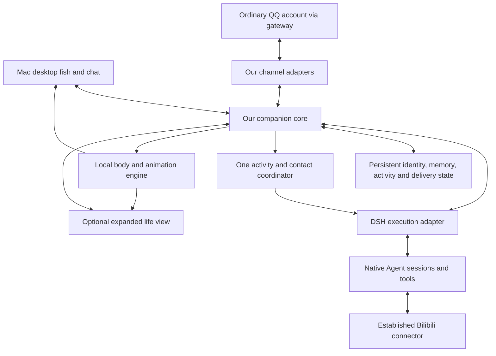

# Project Plan: DeepSeek Harness Dafeiyu

- Project ID: `dsh-dafeiyu`
- Revision: v0.4 — independently designed product
- Prepared: 2026-11-04, Asia/Ho_Chi_Minh
- Status: Overall-design proposal; implementation and acceptance remain open
- Current work: Research references and revise the overall design, without changing DSH.
- Continuity: This plan and the [reference study](reference-study.md).
- Previous direction: [v0.3 snapshot](snapshots/plan-v0.3.md); earlier [v0.2](snapshots/plan-v0.2.md) and [v0.1](snapshots/plan-v0.1.md).

## Direction And User Correction

Build a new, coherent DSH-backed Dafeiyu personal companion/assistant. The user
explicitly corrected the previous approach: existing plugins are references for
our design and implementation, not the deliverable installation combination.
The previous preferred-plugin bundle and single-session-centered architecture
are therefore superseded proposals, not accepted baselines.

Own the product's persistent identity, memory semantics, activity coordination,
interaction and operating experience. Keep DSH as the execution/model host;
use established libraries and external gateways for solved capabilities. This
direction does not require implementing a new LLM runtime, QQ protocol, database
engine, or animation framework.

The four requested references are [SurfCore](https://github.com/Mieksido/surfcore),
[surfpet](https://github.com/Mieksido/surfpet),
[QCYTSN/dsh-dafeiyu](https://github.com/QCYTSN/dsh-dafeiyu), and
[dsh-dafeiyu-room](https://github.com/bearyluo/dsh-dafeiyu-room).
The room repository links QCYTSN's project, supporting that name resolution.
Selected source reads and transfer limits are retained in the reference study.

## Confirmed Outcome And Boundaries

The user wants a blue fat fish desktop companion with persistent chat, a memory
system, an ongoing life including autonomous Bilibili activity, and its own
ordinary QQ account through which the user can chat as a normal friend. The user
has a small QQ account available. The Mac and DSH run it locally; shutting down
the Mac stops activity. Server hosting and official QQ bot identities are outside
this selected operating model.

The corrected build direction is confirmed. The architecture, toolkit, storage
binding, model choices, life behavior and visual treatment below are proposals.
Referencing a room project does not by itself confirm a full room/game feature.
No inherited maid persona, mood formula, relationship score, mobile client,
public social activity or old local-chatbot data is selected automatically.

Private-assistant duties still need concrete user scenarios. Proposed examples
are remembering agreements, helping organize information, and following up an
explicitly assigned matter. We should define those alongside companionship,
rather than claim that browsing and casual chat alone establish assistant value.

## Intended Experience

The desktop fish is the everyday presence. Clicking it opens a compact chat;
folding that chat leaves the companion running. QQ is another entrance to the
same relationship. The user can continue a topic, correct a fact, or ask what the
fish has been doing without knowing which DSH execution session is active.

When unoccupied, the fish may pursue an interest, explore Bilibili, continue an
unfinished activity, interact with its virtual environment, or rest. It can later
discuss an actual experience with its source and coverage. It shares selectively,
with a way to become quiet without losing memory or breaking normal replies.

A proposed expanded life view can reveal a room, current activity, recent
experiences and ongoing interests. It is a view of the companion, not a second
character or another memory system. Whether this view is part of first delivery
or a later presentation decision remains open; autonomous life itself stays in
scope either way.

The visual language must distinguish:

- actual external activity, such as reading a video transcript or sending a QQ reply;
- executed virtual-world activity, such as sitting, making tea or sleeping in a room;
- decorative animation or offline display;
- intentions and plans that have not completed.

Virtual experiences can belong to its life, but must retain their virtual-world
provenance. A reading pose cannot prove that an external video was understood.
An offline sleeping picture cannot claim model activity during shutdown.

## System Responsibilities

| Responsibility | Our product owns | Reuse or boundary |
| --- | --- | --- |
| Persistent companion | Stable identity, relationship, persona revisions, scene mappings and current activity | Identity survives DSH session replacement and toolkit changes. |
| Conversation and execution adapter | Route inputs/results, bind execution to the companion, handle busy/cancel/error conditions and context assembly | DSH owns native Agent/model/tool execution and its original session logs. |
| Memory and experience | Evidence, dates, scope, recall policy, corrections, forgetting and migrations | Use a mature store/search implementation; do not let renderer or connectors independently rewrite truth. |
| Life and attention | Select and coordinate activities, rest, user priority, contact and shared budgets | Borrow existing purpose/activity patterns; avoid independent timers that bypass common controls. |
| Channel adapters | QQ identity mapping, message provenance, receipts and reply routing | OneBot/NapCat supplies ordinary-account transport. No new QQ protocol. |
| Desktop and life view | Visible state, chat input, focus/quiet controls, playback and reconnect behavior | Native Mac windowing or a mature desktop framework; no second model client in the UI. |
| Virtual body | Validate/execute bounded actions, movement, animation and completed-action receipts | Local engine handles continuous motion; model calls only when a consequential choice needs one. |
| Maintenance | One coherent installation, settings entry, health view, backup/export and recovery | Dependencies have explicit versions and data ownership; no promise that source control alone backs up live data. |

These responsibilities do not imply separate services or one directory per row.
The initial recommended carrier is a DSH host plugin containing the core and
adapters, supervising one Mac helper. Separating another always-on assistant
backend is not justified by the selected DSH-dependent lifetime at present.
Keep host-specific code behind an explicit adapter so a DSH update does not
redefine the companion's identity or memory semantics.

## Persistent Identity And Execution Sessions

Assign the companion a durable product identity. Map desktop, owner QQ, optional
room and each native DSH execution context to that identity. Store relationship,
memories and unfinished activities against it, with scene and source scopes.
A DSH session ID is an execution reference, not the owner of the companion.

An initial implementation may use one owner conversation session, plus bounded
reading/background work. This is an implementation choice: compaction, a new
conversation or an unavailable session must not replace the character or lose its
memory. Define explicit rebind and migration behavior before advertising continuity.
Never fall back to an unrelated recently used DSH session.

Use one DSH Agent path for desktop and QQ at first. SurfCore's direct-LLM pet chat
is a useful cost tradeoff to understand, but it does not automatically preserve
Agent tools and conversation behavior. Any later lightweight path must go through
our core and preserve input provenance, memory, tasks and receipts.

## Memory And Experience Lifecycle

Keep a single logical memory authority with distinguishable evidence and derived
views. It should cover user facts/agreements, companion identity/interests,
experiences, and unfinished matters. These are information responsibilities,
not four mandatory databases.

A normal path is: preserve input or action evidence → interpret meaning → propose
memory changes → check target, scope, source and revision → commit → retrieve an
appropriate view when needed. Semantic interpretation belongs to the model;
record ownership, allowed operations, source identity, version checks and atomic
state changes belong to deterministic code.

Retain whether a statement came from the owner, an external source, a model
inference, a proposed plan, or a completed virtual/external activity. A video
report must identify what was actually read or seen. A self-generated wake-up
cannot become a user statement; repeated summaries cannot become new evidence.
Conflicting facts keep their scope and time until resolved. A late background
summary must not overwrite a newer correction.

A failed memory operation must leave unrelated valid memory readable. Forgetting
must remove eligibility for recall and re-derivation from withdrawn sources;
physical deletion of original native logs is a separate visible operation.
Provide readable source/history inspection and export, not just an opaque score.
Old local chatbot/persona data remains separate unless migration is selected.

Retrieval must be evaluated on paraphrases, entities, negation, dates and source
coverage. FTS, embeddings, summaries and model selection are candidate retrieval
techniques, not permission mechanisms or guarantees of truth. Do not choose
semantic meaning from keyword lists or copy a reference's numeric weights as
accepted requirements.

## Life, Assistance And Contact

Use a common activity coordinator for user requests, ongoing interests, Bilibili
exploration and virtual-room decisions. It combines current conversation state,
unfinished matters, recent experiences, capabilities, quiet/focus state and
remaining resources. A model can propose what is meaningful; executable actions
remain bounded and validated.

The operating loop is: opportunity/event → assemble relevant context → choose an
activity or rest → validate → execute → record outcome → retain useful experience
→ decide whether/how to share. Support pending, running, waiting, completed,
interrupted and failed outcomes without equating an accepted request with success.
User interaction takes priority. Paused or failed background work retains a
checkpoint and must not block ordinary chat indefinitely.

Borrow the room reference's split: plans choose coarse actions, a local engine
runs motion and confirms completion. There is no need for a model call on every
animation frame. Virtual needs and inventory can be added if they improve the
chosen experience; numerical hunger/affinity/satisfaction is not assumed.

Contact is a separate decision from doing something. Reply through the incoming
channel by default; route proactive contact to one eligible channel according to
explicit preferences and connection state. A visible/focused client is a signal,
not proof of human attention. The same activity should not produce duplicate
QQ and desktop interruptions. Persist meaningful pending messages and delivery
status; ephemeral animation events may expire on reconnect.

A shared focus/quiet control suppresses unsolicited contact while allowing normal
owner conversation. A distinct pause/stop control halts autonomous execution.
Exact behavior of ambient animation while paused is a presentation choice, not
an excuse to keep network/model work running.

Ordinary QQ owner chat is confirmed. Public comments, Bilibili private messages,
posting, spending coins and contact with others remain unselected action scopes.
Browsing access must not silently enable them. External comments and documents
are evidence inputs, not owner instructions or authorization.

## Technology Choices To Resolve

| Choice | Working recommendation | Compared alternative and decision condition |
| --- | --- | --- |
| Host/core | TypeScript/JavaScript core in a DSH plugin, with explicit DSH adapter and pure decision/state modules where useful | A separate backend adds startup, IPC and lifetime ownership. Reconsider only if measured host constraints require isolation or operation beyond DSH's lifetime. |
| Mac desktop | Prefer evaluating a Swift/AppKit helper, drawing on the native Dafeiyu lifecycle; retain a local web renderer option for richer room views | Electron has a direct surfpet interaction example and web UI reuse. Compare actual focus, transparency, multi-screen, Chinese input, rich view fit, startup/resource usage and maintenance before fixing the toolkit. Neither option is runtime-verified here. |
| Local state | SQLite is the preferred persistence candidate for coherent identity, memory edits, action receipts and delivery transactions; Markdown/JSON exports remain readable | Plain files are simpler to inspect but need coordinated recovery for multi-record changes. The DSH runtime's SQLite binding/version remains unverified. Use a mature binding, not a custom database. |
| Search | Start with the evidence/recall contract; compare existing full-text facilities and semantic retrieval using representative inputs | SQLite FTS5 supplies full-text search, not semantic equivalence. Add embeddings/reranking only for demonstrated retrieval gaps and an explicit cost/privacy choice. |
| QQ | OneBot/NapCat gateway plus our owner/scene mapping and message handling | SnowLuma-specific setup is not inherited. Native Mac login coexistence versus a local container gateway needs checking before account changes. |
| Bilibili | Established compatible connector/tools behind our activity adapter | Own goals, scheduling and evidence ingestion. Rebuild site access only if an identified limitation justifies maintaining it. |
| Animation/art | Reuse a mature renderer or bounded engine and a documented asset pipeline | Existing source/assets have separate notices. No new renderer, game world or unreviewed art copying is implied by this proposal. |

SQLite's documented [transaction semantics](https://sqlite.org/transactional.html)
and [FTS5](https://sqlite.org/fts5.html) inform that candidate, not its fitness on the
installed host. Electron's official [window documentation](https://www.electronjs.org/docs/latest/api/browser-window)
provides the alternative's general capabilities; the four-project study carries
the actual reference implementations and applicability limits.

## Installation, Operation And Recovery

Present the future product as one maintained DSH extension with its supervised
Mac companion, one settings/health entry and owned state. This does not mean every
external gateway binary must be bundled. Show which account/service is connected,
what the fish is doing, what is paused, and which failure needs the user's action.
Keep passwords, gateway tokens and service keys in trusted credential storage,
not memory, renderer state or this repository.

Use a small versioned command/event boundary between host and helper. Parent-child
stdio is a concrete candidate for a supervised helper; independent viewers would
need authenticated local transport. Reconnect needs both current state and a
known event position/boot identity. Durable conversation recovery and message
receipts remain separate from a live animation/event cursor.

Mac sleep/shutdown stops model/network activity. Restart resumes known unfinished
state without invented offline experiences or an old-message burst. Uncertain
external sends are not blindly retried. If QQ or Bilibili is unavailable, preserve
local conversation and memory. If the desktop client fails, the core must report
its actual availability rather than starting a second personality as fallback.

Back up data with its schema/version and source references. Package rollback
must account for state migrations; keep prior data before converting, retain
failure evidence and do not overwrite newer memories merely to reinstall old
code. Exact backup destination/cadence and retention policy remain undecided.
Paths, ports, timezone, accounts and run bindings come from trusted configuration.
Use Asia/Ho_Chi_Minh unless the user changes their choice; do not inherit another
project's Beijing settings or tariff assumptions.

## Scope Of Our Development

Own the integrated companion behavior, core state/memory contracts, activity and
contact coordination, native DSH adaptation, Mac interaction and unified operation.
Reuse host execution and mature protocol/storage/rendering components where fit
is established. Custom development is the user's selected product direction;
it is not justified by claiming no usable plugins exist.

The implementation destination has not been chosen. This PM Advisor repository
continues to own planning and reference records; it is not automatically the
new product's source/runtime directory. No new target repository, source layout,
dependencies, native binary or account connection was created in this revision.
Do not alter PM Advisor's product requirements or reusable Skill to encode this
engagement's design choices.

## Delivery And Evidence Proposal

Preserve all confirmed goals while arranging work around complete flows:

| Stage | Reviewable result | Acceptance evidence and stop conditions |
| --- | --- | --- |
| Design contracts | Product-owned identity, memory, activity/receipt, channel and helper boundaries; toolkit/storage decision with measured limitations | User reviews the whole experience. Unresolved DSH bindings or Mac interaction keep dependent choices provisional. |
| First coherent companion | Our core, DSH execution, desktop chat and durable identity/memory work together | Desktop chat survives compaction/restart; replacement execution session preserves the fish's identity and knowledge. A second independent pet chatbot fails this stage. |
| Ordinary QQ continuity | Available small account and main-account friend chat bind to the same companion | Real two-way delivery, source/owner scoping, corrections across entrances, disconnect and uncertain-send recovery. User completes login/QR confirmation. |
| Autonomous life | Our coordinator uses an established Bilibili connector and a local body/view where selected | An actual bounded activity produces provenance, a useful memory and an optional single-channel share. Room activity receipts and external activity receipts remain distinguishable. |
| Whole-use observation | Joined behavior over normal conversation, absence, sleep/wake and faults | User accepts continuity, helpfulness, life rhythm and attention burden. Measure model calls/tokens, actual cost where available, resource use and recovery work. |

Freeze relevant cases, limits and versions before behavioral checks. Include
changing execution sessions, a late memory update after correction, forgotten
source re-ingestion, ordinary prose with control-like words, failed memory work,
virtual versus external experiences, missing video content, user interruption,
QQ delivery uncertainty, helper restart, multi-screen/input behavior and focus/pause.
Self-checks and maintainer test counts do not provide independent evaluation or
user acceptance. Synthetic room benchmarks do not forecast total daily model cost.

## Current Evidence And Remaining Decisions

The existing Mac/DSH checks remain dated observations from earlier revisions:
DSH `/Applications/DeepSeek Harness.app` `0.2.1-rc.5`, `arm64`, and desktop profile
`/Users/hy-yin/.dsh/profiles/desktop`. Old installed `dsh-pet`/`dsh-chatbot` and their
data remain unchanged. These facts are not proof that a new implementation works.

The [reference study](reference-study.md) identifies exact inspected commits,
source paths, transfer lessons and evidence limits. This revision involved public
document/source research and document checks only, with no upstream test run,
DSH execution, account login, message, installation or model request.

The user's own-product direction, local carrier and ordinary QQ account are
settled. Further product decisions are the assistant's concrete everyday duties,
character/relationship, whether an expanded room is wanted, contact/resource
limits and Bilibili account setup. These do not reopen the corrected build goal.

Technical decisions remain: installed DSH extension contracts, Mac shell and
renderer, storage binding, privacy/scenario scopes and a bounded implementation
work package. The next design review should assess these owned responsibilities
and the full experience, rather than approve a third-party plugin shopping list.
This is a proposed architecture; it is neither implemented nor accepted.
